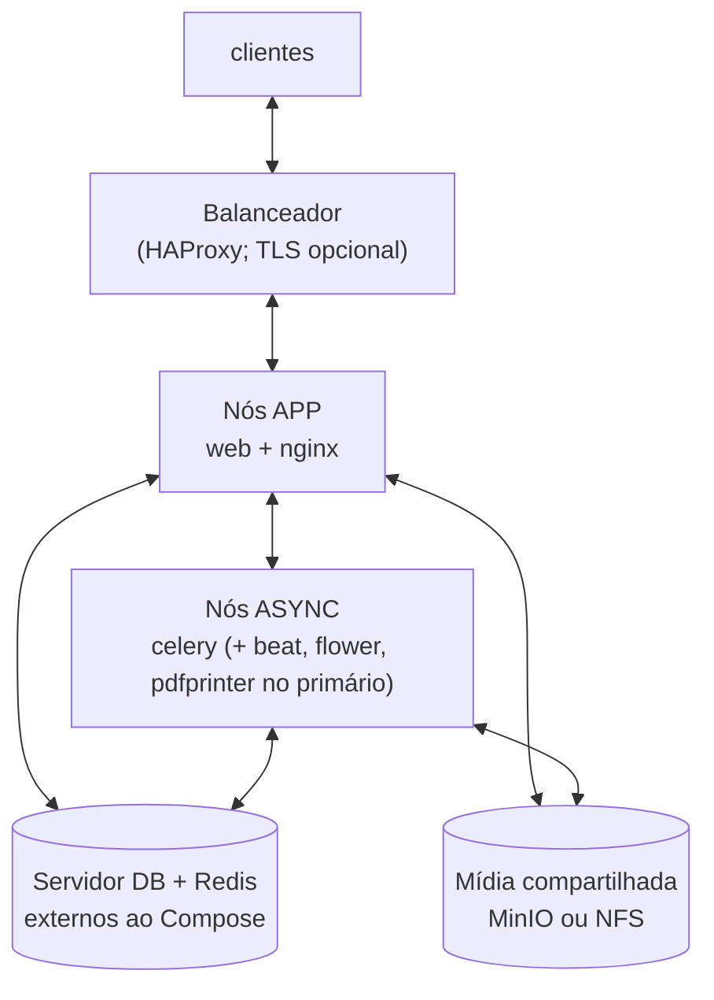

# Guia de Implantação do SUAP em Produção
## Ambientes de Homologação e Produção com Automação via `suap-setup`

**Projeto de automação:** [suap-setup](https://github.com/danielslz/suap-setup)
**Projeto de deploy em containers:** `suap_deploy` (GitLab COSINF/IFRN)
**Sistema:** [SUAP — Sistema Unificado de Administração Pública](https://portal.suap.ifrn.edu.br)

> **Como ler este guia.** As seções 1 a 8 são comuns. Depois, escolha **uma** rota:
> a **Parte A** (máquina física ou VM, instalação nativa) ou a **Parte B** (Docker, via `suap_deploy`).
> A **Parte C** (banco de dados, balanceamento, mídia, backup, monitoramento e checklist) vale para as duas.

## Sumário
- [1. Introdução](#1-introdução)
- [2. Visão geral do SUAP](#2-visão-geral-do-suap)
- [3. Filosofia de automação: por que usar o suap-setup](#3-filosofia-de-automação-por-que-usar-o-suap-setup)
- [4. Escolha da rota de implantação](#4-escolha-da-rota-de-implantação)
  - [4.1. Onde cada tarefa vive no suap-setup](#41-onde-cada-tarefa-vive-no-suap-setup)
- [5. Planejamento de ambientes](#5-planejamento-de-ambientes)
- [6. Dimensionamento de máquinas/VMs](#6-dimensionamento-de-máquinasvms)
  - [6.1. Homologação (configuração mínima)](#61-homologação-configuração-mínima)
  - [6.2. Produção (configuração recomendada — segmentada)](#62-produção-configuração-recomendada--segmentada)
  - [6.3. Por que segmentar em VMs separadas?](#63-por-que-segmentar-em-vms-separadas)
- [7. Arquitetura de referência](#7-arquitetura-de-referência)
- [8. Pré-requisitos gerais](#8-pré-requisitos-gerais)
- [Parte A — Máquina física ou VM (instalação nativa)](#parte-a--máquina-física-ou-vm-instalação-nativa)
- [9. Implantação nativa — Homologação](#9-implantação-nativa--homologação)
  - [9.1. Passo a passo](#91-passo-a-passo)
  - [9.2. Ajustes específicos de homologação](#92-ajustes-específicos-de-homologação)
- [10. Implantação nativa — Produção](#10-implantação-nativa--produção)
  - [10.1. VM(s) de Aplicação](#101-vms-de-aplicação)
  - [10.2. Instalação do Nginx (rota nativa)](#102-instalação-do-nginx-rota-nativa)
  - [10.3. VM de Banco de Dados + Redis](#103-vm-de-banco-de-dados--redis)
  - [10.4. VM de Tarefas Assíncronas (Celery)](#104-vm-de-tarefas-assíncronas-celery)
- [11. Atualização nativa](#11-atualização-nativa)
  - [11.1. Executando a atualização](#111-executando-a-atualização)
- [Parte B — Docker (suap_deploy)](#parte-b--docker-suap_deploy)
- [12. Visão geral da rota Docker](#12-visão-geral-da-rota-docker)
  - [12.1. O que é o suap_deploy](#121-o-que-é-o-suap_deploy)
  - [12.2. Modos de imagem: local ou registry](#122-modos-de-imagem-local-ou-registry)
  - [12.3. Profiles: o papel de cada nó](#123-profiles-o-papel-de-cada-nó)
  - [12.4. Drain protocol (deploy sem downtime)](#124-drain-protocol-deploy-sem-downtime)
  - [12.5. Volumes e dados](#125-volumes-e-dados)
  - [12.6. Referências do suap_deploy](#126-referências-do-suap_deploy)
- [13. Preparando o host Docker](#13-preparando-o-host-docker)
  - [13.1. Permissões de `deploy/`](#131-permissões-de-deploy)
  - [13.2. Rede do Docker](#132-rede-do-docker)
  - [13.3. Portas](#133-portas)
- [14. Docker — Homologação (nó único)](#14-docker--homologação-nó-único)
  - [14.1. Passo a passo](#141-passo-a-passo)
  - [14.2. Configuração do `.env` e primeira subida](#142-configuração-do-env-e-primeira-subida)
- [15. Docker — Produção multi-servidor e multi-nó](#15-docker--produção-multi-servidor-e-multi-nó)
  - [15.1. Papéis e profiles](#151-papéis-e-profiles)
  - [15.2. Ordem recomendada de implantação](#152-ordem-recomendada-de-implantação)
  - [15.3. Configurando cada nó com `configure-node.sh`](#153-configurando-cada-nó-com-configure-nodesh)
  - [15.4. TLS e Nginx](#154-tls-e-nginx)
  - [15.5. Balanceador e drain protocol](#155-balanceador-e-drain-protocol)
  - [15.6. Mídia compartilhada](#156-mídia-compartilhada)
  - [15.7. Vault (opcional)](#157-vault-opcional)
  - [15.8. Validação](#158-validação)
  - [15.9. Exemplo: 3 VMs (prova de conceito / homologação distribuída)](#159-exemplo-3-vms-prova-de-conceito--homologação-distribuída)
  - [15.10. Monitoramento dos containers com o Arcane](#1510-monitoramento-dos-containers-com-o-arcane)
- [16. Operação diária (suap-deploy.sh)](#16-operação-diária-suap-deploysh)
  - [16.1. Rotinas recomendadas](#161-rotinas-recomendadas)
  - [16.2. Escalando workers](#162-escalando-workers)
- [17. Docker — Atualização sem downtime](#17-docker--atualização-sem-downtime)
  - [17.1. Rolling update em vários nós](#171-rolling-update-em-vários-nós)
  - [17.2. Modo local em vários nós: compile uma vez e distribua](#172-modo-local-em-vários-nós-compile-uma-vez-e-distribua)
- [18. Serviços de apoio em containers](#18-serviços-de-apoio-em-containers)
- [Parte C — Comum às duas rotas](#parte-c--comum-às-duas-rotas)
- [19. Configuração de banco de dados](#19-configuração-de-banco-de-dados)
  - [19.1. Escolha da versão](#191-escolha-da-versão)
  - [19.2. Instalação](#192-instalação)
  - [19.3. Estrutura de diretórios e disco](#193-estrutura-de-diretórios-e-disco)
  - [19.4. Criação do banco e usuário de aplicação](#194-criação-do-banco-e-usuário-de-aplicação)
  - [19.5. Controle de acesso (`pg_hba.conf`)](#195-controle-de-acesso-pg_hbaconf)
  - [19.6. Tuning de performance (`postgresql.conf`)](#196-tuning-de-performance-postgresqlconf)
  - [19.7. Connection pooling (recomendado)](#197-connection-pooling-recomendado)
  - [19.8. Réplicas de leitura (opcional)](#198-réplicas-de-leitura-opcional)
  - [19.9. Backup do banco](#199-backup-do-banco)
  - [19.10. Preparação da aplicação e primeiro acesso](#1910-preparação-da-aplicação-e-primeiro-acesso)
- [20. Balanceamento de carga e alta disponibilidade](#20-balanceamento-de-carga-e-alta-disponibilidade)
- [21. Armazenamento de mídia (NFS / MinIO)](#21-armazenamento-de-mídia-nfs--minio)
  - [21.1. NFS](#211-nfs)
  - [21.2. MinIO (alternativa escalável)](#212-minio-alternativa-escalável)
    - [Instalação via suap-setup](#instalação-via-suap-setup)
    - [Integração com o SUAP](#integração-com-o-suap)
    - [Migração de NFS para MinIO](#migração-de-nfs-para-minio)
- [22. Política de atualização](#22-política-de-atualização)
- [23. Backup e recuperação de desastres](#23-backup-e-recuperação-de-desastres)
- [24. Monitoramento e logs](#24-monitoramento-e-logs)
- [25. Checklist final de go-live](#25-checklist-final-de-go-live)
- [26. Referências](#26-referências)

---

## 1. Introdução

Este documento descreve o planejamento e a execução da implantação do **SUAP** (Sistema Unificado de Administração Pública) em ambientes de **homologação** e **produção**.

Diferente de tutoriais baseados em instalação manual passo a passo, esta documentação adota como eixo central o **[suap-setup](https://github.com/danielslz/suap-setup)**, um conjunto de scripts de automação criado para eliminar a repetição manual, reduzir erros humanos e padronizar a preparação de ambientes SUAP.

Há duas rotas de implantação, documentadas separadamente:

- **Parte A — Máquina física ou VM (instalação nativa):** pacotes do sistema operacional, `uv`/virtualenv, Supervisor e Nginx instalados diretamente no servidor (Debian, RHEL/Fedora/AlmaLinux, Arch).
- **Parte B — Docker:** imagens e containers orquestrados pelo projeto `suap_deploy`, que o `suap-setup` prepara e opera (inclusive em configurações multi-servidor e multi-nó).

O objetivo é que qualquer desenvolvedor consiga, com o mínimo de intervenção manual, provisionar um ambiente completo, íntegro e reprodutível, tanto para testes/homologação quanto para produção crítica com múltiplos usuários simultâneos.

---

## 2. Visão geral do SUAP

O SUAP é uma plataforma de gestão acadêmica e administrativa mantida originalmente pelo IFRN e adotada por dezenas de Institutos Federais. Entre os módulos típicos estão: Ensino, RH, Almoxarifado, Protocolo, Documentos Eletrônicos, entre outros. Mais detalhes sobre o produto e seus módulos podem ser consultados no [portal oficial do SUAP](https://portal.suap.ifrn.edu.br).

Do ponto de vista de infraestrutura, o SUAP é uma aplicação **Django** que depende de:

| Componente | Função |
|---|---|
| **PostgreSQL** | Banco de dados relacional principal |
| **Redis** | Cache, armazenamento de sessão e broker do Celery |
| **Celery (worker + beat)** | Processamento assíncrono e tarefas agendadas |
| **Gunicorn** | Servidor WSGI da aplicação Django |
| **Nginx** | Proxy reverso, conexões SSL, servidor de arquivos estáticos e mídia |
| **wkhtmltopdf / LibreOffice** | Geração de PDFs e conversão de documentos |
| **Repositório de mídia (NFS, MinIO, AWS S3)** | Armazenamento compartilhado de arquivos |

O SUAP pode ser implantado de duas formas:

- **Instalação nativa (Parte A)** — pacotes do SO + `uv`/virtualenv + Supervisor + Nginx, em máquina física ou VM.
- **Instalação via Docker (Parte B)** — imagens orquestradas pelo projeto `suap_deploy`, com Makefile para gerenciamento dos serviços.

Ambas as formas são suportadas pelo `suap-setup`; a seção 4 ajuda a escolher.

---

## 3. Filosofia de automação: por que usar o suap-setup

Tutoriais e/ou manuais com dezenas de comandos executados manualmente, em sequência estrita, contém alto risco de:

- Esquecimento de um pacote de dependência do sistema operacional;
- Configuração divergente entre servidores;
- Diferença de versão de Python/PostgreSQL entre ambientes;
- Erros de permissão em diretórios de mídia e logs;
- Divergência de configuração do Supervisor/Nginx entre nós de um cluster.

O `suap-setup` resolve esses problemas por meio de:

- **Wizard interativo** (`setup.sh`) que gera um `.env` centralizado, com prompts descritivos e valores padrão para cada variável.
- **Suporte multiplataforma**: Debian/Ubuntu (`apt`), Fedora/RHEL/CentOS/AlmaLinux/Rocky (`dnf`), Arch/Manjaro (`pacman`), macOS (Homebrew, apenas dev) e Docker.
- **Idempotência**: reexecutar um script pula etapas já concluídas sem corromper o que já está pronto.
- **Halt em falhas críticas**: se uma dependência falha ao instalar, o script interrompe imediatamente.
- **Separação de responsabilidades por script**: `suap-dev.sh`, `suap-prod.sh`, `suap-update.sh`, `install-redis.sh`, `install-nginx.sh`.
- **Operação sem trocar de pasta** na rota Docker: `docker/prod/suap-deploy.sh` (build, up, down, update, logs, backup, check…) e `docker/prod/configure-node.sh` (papel do nó em configurações multi-servidor e multi-nó).
- **Delegação para os repositórios oficiais** nas rotas Docker: o suap-setup não mantém `Dockerfile`/`docker-compose` próprios — delega para o compose nativo do SUAP (dev) e para o Makefile do `suap_deploy` (produção).
- **Rollback automático** no script de atualização: se `git pull` ou a instalação de dependências falhar, os serviços são reiniciados automaticamente antes do script encerrar com erro.
- **Cobertura de testes** (via `bats-core`) validando idempotência, roteamento do menu, geração do `.env` e ausência de artefatos Docker locais indevidos.

---

## 4. Escolha da rota de implantação

O SUAP roda em produção de duas formas. Ambas são suportadas pelo `suap-setup` e podem ser combinadas (por exemplo, banco e Redis nativos no host e a aplicação em Docker).

| Critério | Nativa (Parte A) | Docker (Parte B) |
|---|---|---|
| Como roda | Pacotes do SO + `uv`/virtualenv + Supervisor + Nginx | Containers via `docker compose` (projeto `suap_deploy`) |
| Onde roda | Máquina física ou VM com Debian 12+, RHEL-like 9+ ou Arch | Qualquer host Linux com Docker Engine e Compose v2 (Debian 11+, AlmaLinux) |
| Reprodutibilidade | Depende do estado do SO e dos pacotes | Alta: a mesma imagem em todos os nós |
| WAF | Não incluso | OWASP ModSecurity CRS no Nginx do container |
| Limites de recursos | Manual (systemd/Supervisor) | Por container (`DOCKER_*_MAX_MEMORY_SIZE`) |
| Papéis em vários nós | Uma VM por papel; Supervisor escolhe web/Celery | `COMPOSE_PROFILES` por nó (`web`, `celery`, `pdfprinter`…) |
| Atualização sem downtime | Rolling update manual (um nó por vez) | Drain protocol automático no `make restart` (Compose >= 2.30) |
| Atualização | `git pull` + `uv` + reinício do Supervisor | `pull` ou `build` + `restart` |
| Customização do código | Direta no clone | Build local (`./src/suap`) ou imagem de registry |

**Recomendação:** use a **rota Docker** sempre que possível. Ela reduz a divergência entre nós, traz o WAF e o drain protocol prontos e simplifica atualizações. Use a **rota nativa** quando a política da instituição não permitir containers ou quando for necessário integrar a um parque já existente.

### 4.1. Onde cada tarefa vive no suap-setup

| Tarefa | Rota nativa | Rota Docker |
|---|---|---|
| Configurar a aplicação | Menu "Configurar ambiente de produção" (`{distro}/suap-prod.sh`) | Menu "SUAP prod (suap_deploy)" (`docker/prod/docker-setup.sh`) |
| Atualizar | Menu "Atualizar SUAP (produção)" (`{distro}/suap-update.sh`) | `bash docker/prod/suap-deploy.sh update` |
| Servidor web | Menu "Instalar Nginx" | Container Nginx do `suap_deploy` |
| PostgreSQL e Redis | Menus "Instalar PostgreSQL" e "Instalar Redis" (no host) | No host (mesmos menus) **ou** em containers (menus "Redis" e "PostgreSQL" do grupo "Via Docker") |
| Balanceador (HAProxy) | Menu "HAProxy (balanceador do suap_deploy)" — serve às duas rotas | Menu "HAProxy (balanceador do suap_deploy)" (`docker/haproxy-setup.sh`) |
| Configurar o papel de um nó | Escolha do menu do Supervisor (SUAP / Celery / Ambos) | `bash docker/prod/configure-node.sh` |
| Validar a configuração | — | `bash docker/prod/suap-deploy.sh check` |

---

## 5. Planejamento de ambientes

Recomenda-se manter **três ambientes logicamente isolados**, sem compartilhamento de banco de dados ou mídia entre si:

| Ambiente | Finalidade | Perfil de infraestrutura |
|---|---|---|
| **Desenvolvimento** | Uso local dos desenvolvedores (via Docker Compose) | Máquina local / notebook |
| **Homologação** | Testes de aceitação, validação de atualizações, treinamento | Servidor único, dimensionamento mínimo |
| **Produção** | Ambiente crítico, uso pela comunidade acadêmica | Múltiplos servidores segmentados |

**Por que não compartilhar banco entre homologação e produção?** Migrações testadas em homologação não devem vazar para produção antes da janela de manutenção planejada, e dados sigilosos de produção não devem circular em um ambiente com controles de acesso mais permissivos.

O `suap-setup` favorece essa separação porque cada ambiente tem seu próprio `.env`, próprio diretório base (`BASE_DIR`) e pode residir em servidores/VMs completamente distintos.

---

## 6. Dimensionamento de máquinas/VMs

### 6.1. Homologação (configuração mínima)

Ambiente de homologação pode operar em **servidor único**, concentrando aplicação, banco de dados e tarefas assíncronas:

| Recurso | Valor mínimo recomendado |
|---|---|
| vCPUs | 4 |
| RAM | 8 GB |
| Disco (partição de dados/`/opt`) | 60 GB (SSD) |
| Sistema Operacional | Debian 12 (Bookworm) ou AlmaLinux 9 |

### 6.2. Produção (configuração recomendada — segmentada)

Para produção, a recomendação é **segmentar os serviços em VMs distintas**, isolando cargas de trabalho com perfis de consumo diferentes e permitindo escalar cada camada de forma independente:

| Papel da VM | vCPUs | RAM | Disco | Observação |
|---|---|---|---|---|
| **Aplicação (Nginx + Gunicorn)** — 2+ nós | 8 | 16 GB | 100 GB em `/opt` | Escalar horizontalmente conforme carga |
| **Banco de dados + Redis** | 8 | 16 GB | 250 GB em `/var` (SSD NVMe) | Redis pode ficar junto do banco em porte médio |
| **Tarefas assíncronas (Celery)** | 8 | 16 GB | 100 GB em `/opt` | Isolado para não competir com requisições web |
| **Balanceador de carga** | 2 | 4 GB | 20 GB | Ponto único de entrada; redundância recomendada |
| **Servidor de mídia (NFS/MinIO)** | 4 | 8 GB | Conforme volume | Compartilhado entre nós de aplicação |

> **Nota:** os valores refletem o piso recomendado para uma instituição de porte médio. O número de nós de aplicação deve ser recalculado a partir de testes de carga reais (picos de matrícula, editais, etc.).

### 6.3. Por que segmentar em VMs separadas?

- **Isolamento de falhas**: pico de carga na aplicação não compromete o banco.
- **Escalabilidade independente**: novos nós de aplicação sem replicar banco.
- **Zero-downtime em atualizações**: rolling update retirando um nó por vez do pool.
- **Segurança**: banco nunca exposto diretamente à internet.
- **Perfis de hardware distintos**: banco se beneficia de NVMe e RAM; aplicação de mais vCPUs.

---

## 7. Arquitetura de referência

```
                                   ┌────────────┐
                                   │  Usuários  │
                                   └─────┬──────┘
                                         │ HTTPS
                                         ▼
                         ┌────────────────────────────────┐
                         │   Balanceador de Carga (HA)    │
                         │  HAProxy / Nginx — Injeção SSL │
                         └───────────────┬────────────────┘
                     ┌───────────────────┼───────────────────┐
                     ▼                   ▼                   ▼
             ┌───────────────┐  ┌───────────────┐   ┌───────────────┐
             │  App node 1   │  │  App node 2   │   │  App node N   │
             │   Gunicorn    │  │   Gunicorn    │   │   Gunicorn    │
             │   (Django)    │  │   (Django)    │   │   (Django)    │
             └───────┬───────┘  └───────┬───────┘   └───────┬───────┘
                     └──────────────────┼───────────────────┘
                                        ▼
           ┌─────────────────────────────────────────────────────────────┐
           │                    Rede interna / privada                   │
           └─────────────────────────────────────────────────────────────┘
               │                  │                 │                 │
               ▼                  ▼                 ▼                 ▼
       ┌───────────────┐ ┌────────────────┐ ┌───────────────┐ ┌───────────────┐
       │   PostgreSQL  │ │ Redis (cache/  │ │ Celery worker │ │     Mídia     │
       │    (dados)    │ │ sessão/broker) │ │ + celery beat │ │ compartilhada │
       │               │ │                │ │ (assíncrono)  │ │ (NFS / MinIO) │
       └───────────────┘ └────────────────┘ └───────────────┘ └───────────────┘
```

Na rota Docker, esses blocos correspondem aos papéis e *profiles* descritos na seção 15.1.

---

## 8. Pré-requisitos gerais

Antes de iniciar a implantação em qualquer ambiente, são necessários os seguintes pré-requisitos:

- Conta no GitLab da instituição de origem do código com acesso de leitura aos projetos `suap` e, se aplicável, `suap_deploy` e `suap-pdf`.
- Chave SSH cadastrada no GitLab.
- Se optar pela rota Docker: token de acesso pessoal ao registry (escopo `read_registry`), caso use imagens de registry; e o preparo do host descrito na seção 13.
- Acesso `sudo`/root nos servidores de homologação e produção.
- Sistema operacional suportado: **Debian 12+**, **AlmaLinux 9** (ou qualquer RHEL-like 9+: Rocky Linux, CentOS Stream, Fedora), **Arch Linux** (rota nativa); na rota Docker, qualquer Linux com Docker Engine e Compose v2 (testado em Debian 11+ e AlmaLinux).
- DNS configurado apontando para o balanceador (produção) ou para o servidor único (homologação).
- Certificado SSL válido (ou processo de emissão automatizada, ex. Let's Encrypt).
- Firewall liberando apenas portas necessárias (443/80 no balanceador; portas internas restritas à rede privada).

Instalar o `suap-setup` em cada servidor:

```bash
git clone https://github.com/danielslz/suap-setup.git
cd suap-setup
```

---

## Parte A — Máquina física ou VM (instalação nativa)

Nesta rota a aplicação é instalada diretamente no sistema operacional. O `suap-setup` automatiza cada etapa e deve ser executado **em cada servidor**, conforme o papel dele.

## 9. Implantação nativa — Homologação

Em homologação, um **servidor único** concentra aplicação, banco, Redis e tarefas assíncronas (dimensionamento mínimo na seção 6.1).

### 9.1. Passo a passo

Em ordem, no servidor de homologação:

```bash
git clone https://github.com/danielslz/suap-setup.git
cd suap-setup
bash setup.sh
```

No menu, execute (uma de cada vez, repetindo `bash setup.sh`):

1. **Instalar PostgreSQL** — repositório PGDG, cluster, banco e usuário de aplicação (seção 10.3);
2. **Instalar Redis**;
3. **Configurar ambiente de produção** — dependências do SO, locale/timezone, código, virtualenv e Supervisor. No menu do Supervisor escolha **Ambos** (SUAP + Celery);
4. **Instalar Nginx** — proxy reverso com a configuração do SUAP.

Os scripts equivalentes podem ser chamados diretamente:

```bash
sudo bash deb/install-postgres.sh   # ou rpm/ ou arch/ conforme a distribuição
sudo bash deb/install-redis.sh
sudo bash deb/suap-prod.sh
sudo bash deb/install-nginx.sh
```

Variáveis solicitadas pelo wizard na primeira execução da produção nativa: `PYTHON_VERSION`, `BASE_DIR`, `SUAP_DIR`, `VENV_DIR`, `SUAP_GIT_URL`, `GUNICORN_WORKERS`, `GUNICORN_THREADS`, `CELERY_MAX_WORKERS`, `CELERY_MIN_WORKERS`, `CELERY_BROKER_URL` e `CELERY_FLOWER_AUTH`.

Depois, prepare a aplicação e o primeiro acesso (seção 19.10).

### 9.2. Ajustes específicos de homologação

- Utilize um domínio distinto de produção (ex.: `suap-hml.instituicao.edu.br`).
- Configure um banner visual indicando "AMBIENTE DE HOMOLOGAÇÃO".
- Restrinja o envio de e-mails (backend em modo console ou caixa de testes).
- Popule o banco com uma cópia anonimizada/subset dos dados, nunca dados sigilosos completos.

---

## 10. Implantação nativa — Produção

A produção deve seguir a arquitetura segmentada descrita na seção 7, com o `suap-setup` executado **em cada VM**, cada uma assumindo um papel específico. Em todas, comece por:

```bash
git clone https://github.com/danielslz/suap-setup.git
cd suap-setup
bash setup.sh
```

### 10.1. VM(s) de Aplicação

Selecione **Configurar ambiente de produção** no menu (script `{distro}/suap-prod.sh`).

O script `suap-prod.sh` realiza:

- Instalação de dependências do sistema (halt em falha);
- Configuração de locale (`pt_BR.UTF-8`) e timezone;
- Clone raso do código (`git clone --depth 1`) ou atualização;
- Criação de virtualenv Python 3.12+ (versão configurável via `PYTHON_VERSION` no `.env`) e instalação de dependências;
- Menu interativo para configurar o Supervisor (SUAP / Celery / Ambos);
- Deploy das configurações do Supervisor com recarga condicional;
- Ajuste de permissões (`chown www-data`).

Caminhos do Supervisor por distribuição:

| Distribuição | Diretório de configuração |
|---|---|
| Debian/Ubuntu | `/etc/supervisor/conf.d/` |
| Fedora/RHEL/AlmaLinux/Rocky | `/etc/supervisord.d/` |
| Arch Linux | `/etc/supervisor.d/` |

### 10.2. Instalação do Nginx (rota nativa)

```bash
bash deb/install-nginx.sh   # ou rpm/ ou arch/ conforme a distribuição
```

A configuração provida automaticamente inclui:

- Upstream com política `least_conn` na porta 8000;
- `client_max_body_size 100m` (uploads de documentos);
- Entrega direta de estáticos (`/opt/suap/static/`) e mídia (`/opt/suap/deploy/media/`) sem passar pelo Gunicorn;
- Páginas de erro customizadas (500, 502, 503, 504, 413);
- Log customizado com tempos de requisição e upstream;
- Buffers de proxy aumentados para respostas grandes;
- Bloco de servidor secundário na porta 8001 (para uso interno/monitoramento).

### 10.3. VM de Banco de Dados + Redis

Instalar os serviços de banco e cache nesta VM:

```bash
cd suap-setup
bash setup.sh
```

Selecione **Instalar Redis** e depois **Instalar PostgreSQL** (grupo "Serviços (no host)"), ou execute-os diretamente:

```bash
sudo bash deb/install-redis.sh      # ou rpm/ ou arch/ conforme distribuição
sudo bash deb/install-postgres.sh   # ou rpm/ ou arch/ conforme distribuição
```

O script de instalação do PostgreSQL (`install-postgres.sh`) realiza automaticamente:

1. Adiciona o repositório oficial PGDG (versão configurável via `POSTGRES_VERSION`, padrão: 16);
2. Instala os pacotes do PostgreSQL;
3. Inicializa o cluster (initdb) e inicia o serviço;
4. Oferece criação interativa do banco e usuário de aplicação (nome do banco, usuário e senha via prompt);
5. Configura `pg_hba.conf` com `scram-sha-256` para o usuário criado;
6. Configura `password_encryption = scram-sha-256`;
7. Pergunta se o PostgreSQL deve escutar apenas em localhost ou em todos os endereços (para VMs separadas);
8. Exibe resumo com string de conexão.

Para tuning avançado, réplicas de leitura e connection pooling, ver seção 19. Para subir Redis/PostgreSQL em containers, ver a seção 18.

### 10.4. VM de Tarefas Assíncronas (Celery)

Nesta VM, configure **apenas o Celery** no menu do Supervisor (worker + beat), sem subir o processo web. Isso garante que picos de processamento assíncrono não disputem CPU com requisições HTTP em tempo real.

Variáveis relevantes no `.env`:

| Variável | Descrição | Exemplo (produção) |
|---|---|---|
| `GUNICORN_WORKERS` | Workers do Gunicorn por nó de aplicação | `5` (ajustar: `2×vCPU+1`) |
| `GUNICORN_THREADS` | Threads por worker | `1` |
| `CELERY_BROKER_URL` | URL do broker Redis | `redis://<ip-interno-redis>:6379/3` |
| `CELERY_MIN_WORKERS` | Mínimo de workers Celery | `2` |
| `CELERY_MAX_WORKERS` | Máximo de workers Celery | `5` |
| `CELERY_FLOWER_AUTH` | Autenticação do painel Flower | Usuário/senha fortes |

> **Atenção de segurança:** o valor padrão de `CELERY_FLOWER_AUTH` é `admin:admin`. Este valor **deve obrigatoriamente ser trocado** em produção, e o painel Flower não deve ficar exposto publicamente — mantenha-o acessível apenas via rede interna/VPN.

---

## 11. Atualização nativa

O `suap-setup` fornece scripts dedicados de atualização para a rota nativa (menu **Atualizar SUAP (produção)**).

### 11.1. Executando a atualização

```bash
sudo bash deb/suap-update.sh   # ou rpm/ ou arch/ conforme distribuição
```

Fluxo executado automaticamente:

1. Para todos os serviços do Supervisor;
2. Atualiza o código-fonte (`git pull`);
3. Atualiza dependências Python via `uv`;
4. Pergunta ao operador se deseja rodar `migrate`;
5. Pergunta se deseja rodar `collectstatic`;
6. Pergunta se deseja rodar `sync_permissions`;
7. Corrige permissões dos diretórios (`chown www-data`);
8. Reinicia os serviços do Supervisor;
9. Exibe status e resumo das ações realizadas.

> **Rollback automático:** se o `git pull` ou a instalação de dependências falhar, os serviços são reiniciados automaticamente na versão anterior antes do script encerrar com erro.

Em ambientes com múltiplos nós, aplique **um nó por vez** e consulte a política de atualização (seção 22).

---

## Parte B — Docker (suap_deploy)

Nesta rota a aplicação roda em containers orquestrados pelo projeto **`suap_deploy`**. O `suap-setup` **não mantém** `Dockerfile` nem `docker-compose` próprios: ele clona o `suap_deploy`, executa o `make setup` dele e oferece atalhos para operá-lo. Toda a lógica de composição, profiles e drain protocol vive no `suap_deploy`.

## 12. Visão geral da rota Docker

### 12.1. O que é o suap_deploy

Repositório de deploy que orquestra o SUAP com Docker Compose, sem depender de Vault ou de registry (ambos são opcionais). Não contém código de aplicação: o código do SUAP e do `suap-pdf` vem de repositórios próprios, clonados em `./src/` (modo local) ou embutidos nas imagens (modo registry).

Serviços do `docker-compose.yml`:

| Serviço | Função |
|---|---|
| `nginx` | Terminação TLS, WAF (OWASP ModSecurity CRS) e proxy reverso para o web (portas 80, 443 e 8080) |
| `web` | Gunicorn rodando o Django; health check em `/ht/` |
| `celery` | Workers assíncronos (escaláveis) |
| `celery-beat` | Scheduler de tarefas agendadas (**um único nó** do cluster) |
| `celery-flower` | Painel de monitoramento do Celery na porta 5555 (**um único nó**) |
| `pdfprinter` | Geração de PDFs (`suap-pdf`) |
| `ai` | Serviço de IA (opcional) |
| `db` / `redis` | PostgreSQL e Redis em container — **somente homologação** |
| `cron` | Legado/descontinuado — substituído pelo `celery-beat` |

### 12.2. Modos de imagem: local ou registry

O `make setup` pergunta `URL do registry (ou 'local')`:

| Modo | O que faz | Quando usar |
|---|---|---|
| `local` | Clona `./src/suap` e `./src/suap-pdf`, ativa o `docker-compose.override.yml` (bind do código) e exige `make build` (10–20 min na primeira vez) | Quando você customiza o SUAP ou não tem registry |
| URL de registry | Grava `SUAP_IMAGE`, `SUAP_PDF_IMAGE` e `SUAP_AI_IMAGE` apontando para o registry; não clona nem faz build; usa `docker compose pull` | Produção e múltiplos nós (rápido e idêntico em todos) |

O `make setup` é idempotente: pode ser executado várias vezes e lê o modo atual a partir de `SUAP_IMAGE`. Para trocar de modo, execute-o de novo e responda diferente no prompt.

### 12.3. Profiles: o papel de cada nó

O `COMPOSE_PROFILES` no `.env` define **quais containers sobem** em cada nó:

| Profile | Sobe |
|---|---|
| `default` | web, nginx, pdfprinter, celery (nó de aplicação completo) |
| `web` | só web + nginx (separar o front em outro nó) |
| `pdfprinter` | só o pdfprinter (isolar a geração de PDF) |
| `celery` | workers celery (escaláveis para várias instâncias) |
| `celery-beat` | scheduler (**apenas UM nó** em todo o cluster) |
| `celery-flower` | UI de monitoramento em `:5555` (**apenas UM nó**) |
| `ai` | serviço de IA |
| `local-db`, `local-redis` | PostgreSQL e Redis em container (**só homologação**) |

`default` já inclui `web`, `pdfprinter` e `celery`; os profiles granulares servem para **fatiar** os serviços entre nós. `celery-beat` e `celery-flower` ficam fora do `default` justamente para não serem duplicados. A combinação por papel está na seção 15.1.

### 12.4. Drain protocol (deploy sem downtime)

O endpoint `/ht/` do SUAP lê `deploy/status.txt`: `healthy` responde 200 (o balanceador mantém o nó) e `drain` responde 503 (o balanceador retira o nó sem matar requisições em voo). Com Docker Compose >= 2.30 isso é automático:

- ao **parar** (`down`/`stop`/`restart`), o Nginx escreve `drain`, espera `DRAIN_SECONDS` e só então encerra graciosamente (`SIGQUIT`, até 6 min para a requisição mais longa); o web para depois;
- ao **subir**, o web escreve `healthy`.

> **Atenção:** o drain **não** roda no recreate do `docker compose up -d`. Para atualizar um stack em execução use sempre `restart` (ou o comando `update` do `suap-deploy.sh`), nunca `up`.

### 12.5. Volumes e dados

`make down` para os containers e remove os volumes `suap_static`, `suap_docker` e `suap_docs` (são recriados atualizados no próximo `up`), mas **preserva** `suap_pgdata`. `docker compose down -v` apaga todos, inclusive o banco local — use apenas de propósito. Os dados de runtime (logs, uploads, backups, sessões) ficam no diretório `deploy/` do `suap_deploy`, que **não é código**, apesar do nome.

### 12.6. Referências do suap_deploy

A documentação do próprio projeto é a fonte da verdade para o que acontece dentro dos containers: `README.md`, `docs/ADVANCED.md` (multi-servidor, registry, TLS, mídia), `docs/FAQ.md` (problemas comuns), `contrib/multi-node/README.md` (drain e HAProxy) e `contrib/vault/README.md` (geração do `.env` via Vault).

---

## 13. Preparando o host Docker

O `suap_deploy` só orquestra containers: ele **não instala** o Docker nem prepara o sistema operacional. Em um host limpo, faça o seguinte **antes** do `suap-setup`:

| Item | Detalhe |
|---|---|
| Docker Engine + Compose v2 | O `suap-setup` oferece instalar (`docker/install-docker.sh`) quando não encontra o Docker. Para o drain protocol é necessário Compose >= 2.30 |
| `git`, `make`, `openssl`, `python3`, `sudo` | Usados pelo `make setup` |
| Usuário `www-data` com **UID/GID 33** | Os containers escrevem em `deploy/` com esse id |
| Locale `pt_BR.UTF-8` e timezone | Ex.: `America/Recife` ou sua região |
| NTP (chrony) | Em cluster, relógios desalinhados quebram tarefas agendadas e tokens |
| Recursos mínimos (nó único) | 8 vCPU, 16 GB de RAM e ~100 GB livres na partição de `/opt` |

**Debian 11+:**

```bash
apt-get update && apt-get install -y git make build-essential ca-certificates curl gnupg
dpkg-reconfigure locales   # marque pt_BR.UTF-8
dpkg-reconfigure tzdata
id www-data || useradd www-data; usermod -u 33 -o www-data   # UID/GID 33
```

**AlmaLinux / RHEL:**

```bash
yum install -y git make
systemctl enable --now chronyd
localectl set-locale LANG=pt_BR.UTF-8
timedatectl set-timezone America/Recife
useradd www-data; usermod -u 33 www-data   # UID/GID 33
```

### 13.1. Permissões de `deploy/`

Web, Celery e pdfprinter rodam como `www-data` (UID 33). Se `deploy/` (ou `deploy/media/tmp`) pertencer a outro usuário, o Celery entra em crash loop com `PermissionError: ... /opt/suap/deploy/media/tmp/pymp-...`. Correção: `bash docker/prod/suap-deploy.sh fix-perms` (ou `sudo chown -R 33:33 <SUAP_DEPLOY_DIR>/deploy`). O `check` reprova esse estado e `up`/`restart`/`update` do `suap-deploy.sh` se recusam a subir com ele. Em `deploy/media` grande ou em NFS, o `chown -R` pode demorar.

### 13.2. Rede do Docker

O Docker usa por padrão `172.16.0.0–172.31.x`. Se a rede da instituição usa esse bloco, os containers deixam de enxergar serviços externos (DB, Redis, LDAP). Mude a sub-rede em `/etc/docker/daemon.json`:

```json
{
  "bip": "198.18.251.1/24",
  "default-address-pools": [
    { "base": "198.18.252.0/22", "size": 26 }
  ]
}
```

`198.18.0.0/15` é reservado a benchmarking (RFC 2544) e raramente roteado. Depois: `systemctl restart docker` e recrie os containers.

### 13.3. Portas

O Nginx do `suap_deploy` publica as portas **80**, **443** e **8080**. Os padrões dos utilitários do `suap-setup` não colidem com elas (Dockhand em 9093, Arcane em 3552, Redis em 6379, PostgreSQL em 5432), mas, ao alterar `DOCKHAND_PORT` ou `ARCANE_PORT`, evite 80, 443 e 8080 **no mesmo host**. Libere no firewall apenas o necessário: 80/443 no balanceador; no nó de aplicação, apenas o balanceador deve alcançar a 80; DB e Redis só na rede interna.

---

## 14. Docker — Homologação (nó único)

Para homologação, use a rota Docker em **servidor único**, com PostgreSQL e Redis em containers (profiles `local-db` e `local-redis`). Assim o que for validado reflete o comportamento da produção.

### 14.1. Passo a passo

```bash
git clone https://github.com/danielslz/suap-setup.git
cd suap-setup
bash setup.sh
```

No menu, selecione, no grupo "Via Docker":

```
SUAP prod (suap_deploy)
```

Na primeira execução, o wizard solicita:

| Variável | Descrição | Exemplo |
|---|---|---|
| `SUAP_DEPLOY_DIR` | Diretório do repositório `suap_deploy` | `/opt/suap_deploy` |
| `SUAP_DEPLOY_GIT_URL` | URL Git do `suap_deploy` (**obrigatório**) | `git@gitlab.instituicao.edu.br:org/suap_deploy.git` |

> **Nota:** as variáveis de imagem (`SUAP_IMAGE`, `SUAP_PDF_IMAGE`, `SUAP_AI_IMAGE`) ficam no `.env` do próprio `suap_deploy` (gerado pelo `make setup` a partir do `env.sample`), não no `.env` do `suap-setup`.

O script então:

1. Verifica se o Docker está disponível (oferece instalar);
2. Clona o `suap_deploy` em `SUAP_DEPLOY_DIR`;
3. Executa o `make setup` interativo: escolhe o modo de imagem, gera o `.env` (com `SECRET_KEY` e `SUAP_PDF_ACCESS_TOKEN`), ativa o template do Nginx conforme `SSL_ENABLED`, gera um certificado autoassinado se necessário e ajusta as permissões de `deploy/` para o UID 33 (o `suap-setup` repete esse ajuste com `chown -R 33:33`, nunca para o seu usuário);
4. Cria os diretórios de runtime (`deploy/logs/nginx`, `deploy/logs/suap`, `deploy/media`, `deploy/backup`);
5. Apresenta o menu de gerenciamento:

```
1) Fazer pull das imagens e iniciar serviços (modo registry)
2) Fazer build local das imagens e iniciar (modo local)
3) Apenas iniciar serviços (make up)
4) Parar todos os serviços (make down)
5) Reiniciar serviços (make restart)
6) Ver status dos containers
7) Ver logs
8) Acessar shell do container web
9) Executar backup do banco
10) Executar restore do banco
11) Executar setup interativo (make setup)
12) Configurar o papel deste nó (multi-servidor / multi-nó)
13) Verificar a configuração (check)
14) Atualizar: pull/build + restart com drain (update)
0) Sair
```

> Com o stack já no ar, as opções 1 e 2 usam `make restart` (que dispara o drain) em vez de `make up`.

### 14.2. Configuração do `.env` e primeira subida

Edite o `.env` do `suap_deploy` (em `SUAP_DEPLOY_DIR`) e ajuste, no mínimo, `SITE_URL`, `NGINX_SERVER_NAME`, `ALLOWED_HOSTS`, `DATABASE_*`, `EMAIL_*`. Para homologação com DB e Redis locais, o papel é `homolog`:

```bash
bash docker/prod/configure-node.sh --role homolog --site-url https://suap-hml.instituicao.edu.br --yes
```

Depois, escolha o modo e suba:

```bash
# Modo local (build a partir do código)
bash docker/prod/suap-deploy.sh build
bash docker/prod/suap-deploy.sh up

# Modo registry
bash docker/prod/suap-deploy.sh pull
bash docker/prod/suap-deploy.sh up
```

Em banco vazio, inicialize e crie o superusuário:

```bash
bash docker/prod/suap-deploy.sh begin          # create_db + carga_inicial
bash docker/prod/suap-deploy.sh exec python manage.py createsuperuser
```

> O `SUAP_PDF_ACCESS_TOKEN` é gerado pelo `make setup`. Configure o **mesmo valor** no SUAP (Configurações do módulo comum → "Token da API do SuapPDF"); caso contrário a geração de PDF responde `401`. Para ver o valor: `grep ^SUAP_PDF_ACCESS_TOKEN= <SUAP_DEPLOY_DIR>/.env`.

Acesse o endereço de `SITE_URL`. Em homologação, o certificado autoassinado faz o navegador avisar — é esperado. Para os demais ajustes de homologação (domínio, e-mail, dados anonimizados), ver a seção 9.2.

---

## 15. Docker — Produção multi-servidor e multi-nó

Em produção, separe a pilha em papéis dedicados. O `suap_deploy` já suporta isso por meio de **profiles**, e o `suap-setup` automatiza a configuração de cada nó com o `configure-node.sh`.

### 15.1. Papéis e profiles



| Papel (`--role`) | `COMPOSE_PROFILES` | Quantos nós | Observação |
|---|---|---|---|
| `single` | `default,celery-beat,celery-flower` | 1 | Tudo junto (nó único) |
| `full` | `default` | 0 ou mais | Web + nginx + pdfprinter + celery **sem** beat/flower (nó completo de um cluster) |
| `web-beat` | `web,celery-beat,celery-flower` | **exatamente 1** | Web + beat + flower (o único nó com beat e flower; os workers ficam em outros nós) |
| `web-celery-beat` | `web,celery,celery-beat,celery-flower` | **exatamente 1** | O mesmo, **com workers** no próprio nó (permite que o Celery siga rodando se outro nó cair) |
| `app` | `web` | 2 ou mais | Front (web + nginx) atrás do balanceador |
| `async-primary` | `celery,celery-beat,celery-flower,pdfprinter` | **exatamente 1** | Único nó com beat, flower e pdfprinter |
| `async` | `celery` | 0 ou mais | Workers adicionais; escalam à vontade |
| `homolog` | `default,celery-beat,celery-flower,local-db,local-redis` | 1 | Homologação com DB/Redis em container |
| `custom` | lista própria via `--profiles` | — | Qualquer combinação válida |

> **Importante:** `celery-beat` e `celery-flower` devem rodar em **apenas um nó** do cluster. Duplicar o `celery-beat` faz as tarefas agendadas executarem em dobro. O `check` avisa quando um nó os ativa. O profile `cron` é legado.

Dimensionamento e partições de disco por papel: seção 6.2 (aplicação e async usam `/opt`; banco e Redis usam `/var`).

### 15.2. Ordem recomendada de implantação

1. **Servidor de DB + Redis** — nativo (seção 10.3) ou em containers (seção 18). Crie o banco e o usuário de aplicação (seção 19.4).
2. **Mídia compartilhada** — MinIO ou NFS (seção 21).
3. **Nó `async-primary`** (beat, flower, pdfprinter, workers).
4. **Nós `async` adicionais**, se necessário.
5. **Nós `app`** (um por vez).
6. **Balanceador** com health check no `/ht/` (seção 15.5 e 20).
7. **Inicialização do banco** em **um único nó**: `begin` e `createsuperuser` (somente em banco novo).

Em cada nó de aplicação ou async, o fluxo é o mesmo:

```bash
git clone https://github.com/danielslz/suap-setup.git && cd suap-setup
bash setup.sh                                  # "SUAP prod (suap_deploy)": clona o suap_deploy e roda o make setup
bash docker/prod/configure-node.sh             # define o papel e as conexões deste nó
bash docker/prod/suap-deploy.sh check          # valida a configuração
bash docker/prod/suap-deploy.sh update         # pull/build e sobe (ou reinicia com drain)
```

### 15.3. Configurando cada nó com `configure-node.sh`

O script edita o `.env` do `suap_deploy` com segurança: faz **backup** (`.env.bak-<data>`), mostra o que muda (segredos mascarados), grava com permissão `600` e ajusta o symlink do Nginx. Sem argumentos e em terminal interativo ele pergunta cada item mostrando o valor atual; com opções, é totalmente não interativo (`--yes`). `--dry-run` mostra as alterações sem gravar.

`SECRET_KEY` do Django: o `make setup` gera uma chave nova em cada servidor, mas todos os nós do cluster devem ter a **mesma**; informe a do primeiro nó nos demais com `NODE_SECRET_KEY='...'` (mínimo 32 caracteres, sem os caracteres proibidos abaixo; se a sua tiver, edite o `.env` à mão).

Senhas **não** são aceitas por argumento (ficariam no histórico do shell): use o prompt silencioso ou as variáveis `NODE_SECRET_KEY`, `NODE_DB_PASSWORD`, `NODE_REDIS_PASSWORD` e `NODE_S3_SECRET_KEY`. Elas não podem conter espaço, `$`, `#`, aspas, crase ou barra invertida (o `make` e o Compose as interpretariam).

**Nó de aplicação (atrás do balanceador que termina o TLS):**

```bash
NODE_DB_PASSWORD='...' NODE_REDIS_PASSWORD='...' \
bash docker/prod/configure-node.sh --role app \
  --db-host 10.0.1.5 --db-name suap --db-user suap_app \
  --redis-host 10.0.1.5 \
  --ssl false --site-url https://suap.instituicao.edu.br \
  --trusted-proxies 10.0.0.10 --drain-seconds 20 --yes
```

**Nó async primário:**

```bash
NODE_DB_PASSWORD='...' NODE_REDIS_PASSWORD='...' \
bash docker/prod/configure-node.sh --role async-primary \
  --db-host 10.0.1.5 --db-user suap_app --redis-host 10.0.1.5 \
  --flower-auth operador:SenhaForte123 --yes
```

**Nós async adicionais:**

```bash
bash docker/prod/configure-node.sh --role async --db-host 10.0.1.5 --redis-host 10.0.1.5 --yes
```

**Storage de mídia em MinIO/S3 (qualquer papel):**

```bash
NODE_S3_SECRET_KEY='...' bash docker/prod/configure-node.sh \
  --s3-endpoint http://10.0.1.20 --s3-access-key suap-app --yes
```

Opções completas: `bash docker/prod/configure-node.sh --help`. O que o script altera no `.env`:

| Opção | Variáveis do `.env` |
|---|---|
| `--role` / `--profiles` | `COMPOSE_PROFILES` |
| `--db-*` | `DATABASE_HOST`, `DATABASE_PORT`, `DATABASE_NAME`, `DATABASE_USER`, `DATABASE_PASSWORD` |
| `--redis-host` / `--redis-port` | `REDIS_URL`, `REDIS_LOCATION` (db 2), `SESSION_LOCATION` (db 3), `CELERY_BROKER_URL`, `CELERY_RESULT_BACKEND` (db 1). A senha vai em `REDIS_PASSWORD` e `SESSION_PASSWORD` (Django) **e** dentro das URLs do Celery, no formato `redis://:SENHA@host:6379/1`, codificada (ver a nota abaixo) |
| `--ssl` | `SSL_ENABLED`, o symlink `nginx/active/server.conf.template` e `SECURE_PROXY_SSL_HEADER` (`false` → `HTTP_X_FORWARDED_PROTO,https`; `true` → vazio) |
| `--site-url` | `SITE_URL`, `NGINX_SERVER_NAME` e `ALLOWED_HOSTS` (**mesclado**: mantém as entradas atuais e garante `localhost`, `127.0.0.1`, `web` e `nginx`) |
| `--trusted-proxies` / `--drain-seconds` | `TRUSTED_PROXIES`, `DRAIN_SECONDS` |
| `--s3-*` | `DEFAULT_FILE_STORAGE`, `AWS_S3_ENDPOINT_URL`, `AWS_ACCESS_KEY_ID`, `AWS_SECRET_ACCESS_KEY` |
| `--flower-auth` | `FLOWER_BASIC_AUTH` |

> **`ALLOWED_HOSTS` precisa ter `web` e `nginx`.** Os health checks do compose acessam o web por `http://web:8000/ht/` e o nginx por `http://nginx:80/ht/`; o Django só os aceita se esses nomes estiverem em `ALLOWED_HOSTS`. Sem `web`, o log mostra `Invalid HTTP_HOST header: 'web:8000'. You may need to add 'web' to ALLOWED_HOSTS`, o web fica unhealthy e o nginx não sobe. O `configure-node.sh --site-url` mescla esses nomes (sem apagar os que já existem), e o `check` reprova a ausência de `web`. Para corrigir à mão: `ALLOWED_HOSTS=<seu-domínio>,localhost,127.0.0.1,web,nginx`.

> **Senha do Redis e o Celery.** O Django lê a senha de `REDIS_PASSWORD`/`SESSION_PASSWORD`, mas o Celery só conhece `CELERY_BROKER_URL` e `CELERY_RESULT_BACKEND`: a senha precisa estar **dentro** da URL, com o `:` antes dela (`redis://:SENHA@host:6379/1`). Escrever `redis://SENHA@host` faz o Redis ler a senha como *nome de usuário* e o worker fica em loop com `invalid username-password pair or user is disabled`. O `configure-node.sh` monta as URLs certas (codificando caracteres como `@`, `:`, `/` e `%`); `--redis-host` é opcional se você só quer trocar a senha (host e porta atuais são reaproveitados).

Os demais itens do `.env` (e-mail, limites de memória, OAuth gov.br, Sentry etc.) continuam sendo editados à mão, conforme o `env.sample`.

Para DB e Redis externos, o `host.docker.internal` (já configurado no compose via `extra_hosts: host-gateway`) resolve para o próprio host do nó, útil quando o banco roda **no mesmo servidor**. Em servidores separados use o IP ou hostname.

### 15.4. TLS e Nginx

- **Atrás de balanceador que termina o TLS:** use `SSL_ENABLED=false` (`--ssl false`). O Nginx passa a escutar só na porta 80 e o health check do balanceador fica correto. Com `SSL_ENABLED=true` a porta 80 responde `301` para tudo, e o HAProxy conta `3xx` como saudável e nunca enxerga o `drain`.
- **Nó único sem balanceador:** `SSL_ENABLED=true` com certificado em `/etc/ssl/suap/nginx/fullchain.crt` e `privkey.key` (`chmod 644` no `.crt` e `600` no `.key`). Em produção use certificado real (Let's Encrypt ou CA institucional); o autoassinado do `scripts/gen-cert.sh` serve apenas para homologação. A renovação (por exemplo, `certbot`) fica a cargo do host. Depois de trocar o certificado: `bash docker/prod/suap-deploy.sh restart`.
- **`SECURE_PROXY_SSL_HEADER` com o TLS no balanceador.** O `env.sample` traz essa variável vazia, e (conforme o `settings_base.py` do SUAP) vazia faz o Django ignorar o `X-Forwarded-Proto`: ele trataria toda requisição como HTTP, mesmo vinda do HTTPS do balanceador, gerando links e redirecionamentos com `http://`. Com `SSL_ENABLED=false`, o `configure-node.sh --ssl false` define `SECURE_PROXY_SSL_HEADER=HTTP_X_FORWARDED_PROTO,https` (e `--ssl true` o esvazia de volta); o `check` avisa quando o nó tem SSL desligado e o valor vazio. O HAProxy gerado pelo `haproxy-setup.sh` envia `X-Forwarded-Proto: https`.
- `TRUSTED_PROXIES` deve conter o IP/CIDR do balanceador para que os logs e o Django vejam o IP real do cliente. Para mais de um proxy, o `suap_deploy` exige repetir a diretiva `set_real_ip_from` dentro do valor (ver o comentário no `env.sample`).
- O `nginx/active/server.conf.template` é um **symlink gerado em runtime**; sem ele o Nginx não sobe. O `make setup` e o `configure-node.sh --ssl` o criam. O alvo precisa ser **relativo** (`../templates/...`).

**Portas de um nó e acesso direto antes do balanceador.** O que um nó `app` expõe:

| Porta no host | O que é | Observação |
|---|---|---|
| 80 | Nginx (HTTP puro com `SSL_ENABLED=false`) | É a entrada do nó; o balanceador aponta para ela |
| 443 | Publicada pelo compose, mas o Nginx só escuta nela com `SSL_ENABLED=true` | Com SSL desligado a conexão é aceita e fechada: o Firefox mostra `PR_END_OF_FILE_ERROR` ao abrir `https://<ip-do-nó>` |
| 8080 | Nginx, para terminais Java legados | Não use para outros serviços no mesmo host |
| 8000 | Gunicorn dentro do container `web` | **Não é publicada no host**: de fora ela nunca responde |
| 3553 / 5555 / 9000 | Arcane Agent, Flower e pdfprinter (quando existem no nó) | Rede interna |

Abrir o nó pelo navegador **antes** do balanceador não funciona por três motivos: o Django recebe `Host: <ip>` (que não está em `ALLOWED_HOSTS`) e responde 400; os cookies de sessão e CSRF são `Secure` por padrão e o navegador não os guarda em HTTP, então o login falha; e o navegador pode converter `http://` em `https://` (modo HTTPS-first). O acesso de usuários vem do HTTPS do balanceador. Para **confirmar que o nó está servindo** sem navegador, use o `Host` do site em um `curl`:

```bash
# no próprio nó (use o domínio do SUAP)
curl -i -H 'Host: suap.instituicao.edu.br' http://127.0.0.1/ht/     # esperado: 200 (healthy); 503 = drain
curl -sI -m 3 http://127.0.0.1:8000/ || echo "8000 não publicada (esperado)"
docker ps --format '{{.Names}}\t{{.Ports}}' | grep -E 'nginx|web'
```

### 15.5. Balanceador e drain protocol

**Instalação com o suap-setup.** O item **HAProxy (balanceador do suap_deploy)** do menu (`docker/haproxy-setup.sh`) sobe um HAProxy em container (stack em `/opt/docker/haproxy/`), já com o health check estrito em `/ht/`, pesos por nó, terminação TLS e página de estatísticas. Rode-o em um servidor **sem** o Nginx do `suap_deploy`, que ocupa as portas 80, 443 e 8080:

```bash
HAPROXY_BACKENDS='10.0.0.1:80:3,10.0.0.2:80:1' HAPROXY_SERVER_NAME=suap.instituicao.edu.br \
  bash docker/haproxy-setup.sh
```

O certificado vai em `/etc/ssl/suap/haproxy/suap.pem` (certificado completo + chave privada concatenados); se não existir, o script gera um autoassinado para teste. O script valida a configuração antes de aplicar e, ao mudar nós ou pesos, recarrega o HAProxy sem derrubar conexões. A divisão por peso aparece sob concorrência (o algoritmo é `leastconn`: com requisições instantâneas os nós se alternam). O restante desta seção descreve o que a configuração gerada faz, caso você use um HAProxy próprio (ou o pfSense).

O `sleep` do drain só funciona se durar pelo menos o tempo que o balanceador leva para retirar o nó do pool. Backend HAProxy recomendado:

```haproxy
backend suap-app
    option httpchk
    http-check send meth GET uri /ht/ ver HTTP/1.1\r\nHost:\ suap.instituicao.edu.br
    http-check expect status 200
    retries 3
    option redispatch 1
    timeout connect 5s
    timeout server 10m
    server web1 10.0.0.1:80 check inter 10000 fastinter 2000 fall 3 rise 2
    server web2 10.0.0.2:80 check inter 10000 fastinter 2000 fall 3 rise 2
```

- Tempo para retirar o nó = `inter + (fall-1) × fastinter` = 10 + 2×2 = **14 s**. `DRAIN_SECONDS` deve ser maior que isso mais uma margem (padrão: 20). Sem balanceador (nó único), use 0.
- `http-check expect status 200`: sem isso o HAProxy conta `3xx` como saudável; um nó com `SSL_ENABLED=true` (301 na porta 80) pareceria saudável e o `drain` (503) só seria visto por acaso.
- `option redispatch 1`: conexão recusada (Nginx parado, nó caído) é repetida em outro servidor, sem erro para o cliente.
- `timeout connect 5s`: valores altos seguram requisições de um nó que some sem responder.
- **pfSense** (*Services → HAProxy → Backend*): em cada servidor, campo *Advanced*: `fastinter 2000 fall 3 rise 2`; em *Advanced settings → Backend pass thru*: `option redispatch 1`; *Connection timeout*: `5000`.

**Teste do drain** (num nó): `bash docker/prod/suap-deploy.sh drain` e acompanhe o HAProxy — o servidor deve ficar DOWN em ~14 s. Depois, `bash docker/prod/suap-deploy.sh healthy`. O drain manual **não sobrevive** a um `up`/`restart`, porque o web escreve `healthy` a cada início; rode `drain` de novo depois de subir se o nó deve continuar fora do pool.

### 15.6. Mídia compartilhada

Em cluster, nós de aplicação e async precisam ver os mesmos uploads. Use **MinIO** (recomendado; sem mount, configurado pelo `.env` com `--s3-endpoint`) ou **NFS** montado em `<SUAP_DEPLOY_DIR>/deploy/media` em cada nó (com dono 33:33). Detalhes e `fstab` na seção 21.

### 15.7. Vault (opcional)

Instituições que guardam segredos no HashiCorp Vault podem gerar o `.env` com `contrib/vault/generate-env.sh` (requer `envconsul` e um token com leitura em `secret/data/suap/*`). Ele mescla `secret/data/suap/principal` com `secret/data/suap/<domínio>` (o do host vence). Depois, use `configure-node.sh` apenas para o papel e a rede do nó. Ver `contrib/vault/README.md` no `suap_deploy`.

### 15.8. Validação

```bash
bash docker/prod/suap-deploy.sh check
```

O comando valida: Docker Compose >= 2.30; `make`; presença do `.env`; `SECRET_KEY`, `DATABASE_PASSWORD` e `SUAP_PDF_ACCESS_TOKEN`; valores de exemplo em `SITE_URL`/`ALLOWED_HOSTS` e a presença de `web` (reprova) e `nginx` (avisa) em `ALLOWED_HOSTS`; `DEBUG`; profiles desconhecidos ou legados; beat/flower ativos (lembrete de nó único) e senha padrão do Flower; coerência entre `SSL_ENABLED`, o template do Nginx e o certificado; conectividade TCP com PostgreSQL e Redis; autenticação no Redis (a senha de `REDIS_PASSWORD` e a credencial de `CELERY_BROKER_URL` são testadas com AUTH/PING) e o formato `redis://:SENHA@host` do broker; gravação do UID 33 nos diretórios de `deploy/` (`media/tmp`, `logs`, `sessions`, `pdf/tmp`…) e `status.txt`. Termina com código de saída 1 se houver falhas.

### 15.9. Exemplo: 3 VMs (prova de conceito / homologação distribuída)

Topologia usada como teste do ambiente de produção, com uma VM grande e duas pequenas, mais um servidor de mídia próprio:

| VM | IP | Papel | `COMPOSE_PROFILES` (papel) |
|---|---|---|---|
| Grande (16 cores / 32 GB) | 192.0.2.50 | web + nginx + pdfprinter + celery | `default` (`full`) |
| Pequena (4 cores / 16 GB) | 192.0.2.51 | web + celery + celery-beat + celery-flower | `web,celery,celery-beat,celery-flower` (`web-celery-beat`) |
| Pequena (4 cores / 16 GB) | 192.0.2.52 | PostgreSQL, Redis e **HAProxy** | — |
| Outra VM | — | Servidor de mídia (NFS) | — |

**Por que o HAProxy fica na 192.0.2.52.** O Nginx do container ocupa 80, 443 e 8080 nos dois nós de aplicação, então o balanceador não pode dividir o host com ele sem um override do Compose. A .52 não roda Nginx e, como já concentra o banco, já é um ponto único de falha: colocar o balanceador ali não piora isso.

**Passo a passo**

1. **.52 — Postgres e Redis** acessíveis pelas outras duas VMs (`listen_addresses`, `pg_hba.conf` para .50 e .51; Redis com senha e `bind` na rede interna). Se o Redis foi criado pelo suap-setup, a senha está em `/opt/docker/redis/.env`.
2. **.50 — papel `full`.** O `env.sample` do suap_deploy traz `COMPOSE_PROFILES=default,celery-beat,celery-flower`: uma .50 subida com a configuração padrão **já está com beat e flower**, o que duplicaria tarefas agendadas quando a .51 os rodar. Se o `COMPOSE_PROFILES` atual já é só `default`, pule o `rm`. Reconfigure e remova os containers:

   ```bash
   NODE_DB_PASSWORD='...' NODE_REDIS_PASSWORD='...' \
   bash docker/prod/configure-node.sh --role full \
     --db-host 192.0.2.52 --redis-host 192.0.2.52 --ssl false \
     --site-url https://suap.instituicao.edu.br --trusted-proxies 192.0.2.52 --yes
   bash docker/prod/suap-deploy.sh compose rm -sf celery-beat celery-flower
   bash docker/prod/suap-deploy.sh check
   bash docker/prod/suap-deploy.sh restart
   ```

   Só reduzir o `COMPOSE_PROFILES` e rodar `restart`/`up` **não** remove esses containers (o Compose só enxerga os profiles ativos): o `rm -sf` é necessário, e o `configure-node.sh` avisa quando um container de beat/flower segue rodando depois de sair dos profiles. Use `--db-name`/`--db-user` se o banco restaurado não usa `suap`/`postgres`. Se o `suap_deploy` foi subido sem o `suap-setup`, defina `SUAP_DEPLOY_DIR` no `.env` do `suap-setup` (`bash docker/prod/suap-deploy.sh dir` mostra o caminho resolvido).
3. **Mídia compartilhada (obrigatória com dois nós web).** O servidor de mídia é uma VM à parte, **fora** dos nós de aplicação: se a mídia fosse exportada de um dos nós web, a queda dele travaria o outro (o NFS `hard` bloqueia os processos que acessam arquivos). Monte o NFS em `<SUAP_DEPLOY_DIR>/deploy/media` na .50 e na .51, com dono 33:33 (seção 21.1). Enquanto a mídia compartilhada não estiver mapeada, **mantenha só a .50 recebendo tráfego** (não suba o web da .51 nem a inclua nos nós do HAProxy): um upload feito na .51 ficaria só no disco local dela.
4. **.51 — instalar o suap_deploy e aplicar o papel `web-celery-beat`** (web, workers, beat e flower).

   **4.1. Instalar o suap_deploy na .51** (se o servidor ainda não o tem; sem isso os comandos abaixo respondem `suap_deploy não encontrado`):

   ```bash
   git clone https://github.com/danielslz/suap-setup.git && cd suap-setup
   bash setup.sh      # escolha "SUAP prod (suap_deploy)", no grupo "Via Docker"
   ```

   O wizard pergunta `SUAP_DEPLOY_DIR` (use o mesmo caminho da .50, por exemplo `/opt/suap_deploy`) e `SUAP_DEPLOY_GIT_URL`; depois o script clona o `suap_deploy` e roda o `make setup` dele, que pergunta o **modo de imagem**. Use **o mesmo modo da .50** (veja com `bash docker/prod/suap-deploy.sh profiles` na .50, linha "Modo de imagem"): `local` exige clonar o código e a imagem do SUAP (compilar em cada nó é o que a seção 17.2 recomenda evitar: compile em **um** nó e copie a imagem), `registry` só baixa as imagens. Terminado o `make setup`, o script abre o menu de gerenciamento: escolha **0 (Sair)**; a configuração do nó vem a seguir.

   **4.2. Aplicar o papel.** O `make setup` gera um `SECRET_KEY` novo em cada servidor, mas em um cluster **todos os nós devem usar o mesmo** (tokens assinados, como links de redefinição de senha, falham entre nós com chaves diferentes). Copie o da .50 (`grep ^SECRET_KEY= <SUAP_DEPLOY_DIR>/.env`) e informe-o aqui:

   ```bash
   NODE_DB_PASSWORD='...' NODE_REDIS_PASSWORD='...' NODE_SECRET_KEY='<SECRET_KEY da .50>' \
   bash docker/prod/configure-node.sh --role web-celery-beat \
     --db-host 192.0.2.52 --redis-host 192.0.2.52 --ssl false \
     --site-url https://suap.instituicao.edu.br --trusted-proxies 192.0.2.52 \
     --flower-auth operador:SenhaForte --yes
   bash docker/prod/suap-deploy.sh check
   ```

   **Subir a .51.** Em modo `registry`: `bash docker/prod/suap-deploy.sh update`. Em modo `local`, **não compile na .51**: copie a imagem da .50 e suba sem build (seção 17.2):

   ```bash
   # na .50 (origem da imagem): copia a imagem e mostra o commit de src/suap
   bash docker/prod/suap-deploy.sh image-copy <usuario>@<ip .51>

   # na .51: mesmo commit do código (o modo local monta src/suap por cima da imagem) e subir sem compilar
   git -C <SUAP_DEPLOY_DIR>/src/suap fetch && git -C <SUAP_DEPLOY_DIR>/src/suap checkout <commit mostrado pelo image-copy>
   bash docker/prod/suap-deploy.sh update --no-build
   ```

   Use `--db-name` e `--db-user` iguais aos da .50 se não forem `suap`/`postgres`. Rode `begin` e `createsuperuser` **só** em banco novo e em um único nó (aqui o banco já foi restaurado de backup). Com 16 GB, web (4G) + celery (4G) + beat (1G) + flower (1G) cabem, mas os 4 cores ficam disputados.
5. **.52 — HAProxy.** Antes dele, confirme cada nó com o `curl` da seção 15.4 (`/ht/` deve dar 200). Enquanto a mídia não estiver compartilhada, aponte o HAProxy **só para a .50** (`HAPROXY_BACKENDS='192.0.2.50:80:1'`) e acrescente a .51 depois, repetindo o comando:

   ```bash
   HAPROXY_BACKENDS='192.0.2.50:80:3,192.0.2.51:80:1' HAPROXY_SERVER_NAME=suap.instituicao.edu.br \
     bash docker/haproxy-setup.sh
   ```

6. **URL do pdfprinter.** O pdfprinter roda só na .50. Em *Configurações do módulo comum*, o campo **"Caminho para o executável do LibreOffice/API do SuapPDF"** deve receber `http://192.0.2.50:9000` (porta publicada pelo compose; o nome `pdfprinter` só resolve dentro da rede Docker da .50) e o campo **"Token da API do SuapPDF"** o valor de `SUAP_PDF_ACCESS_TOKEN`. A configuração fica no banco, então vale para os dois nós. Libere a porta 9000 no firewall apenas para a .50 e a .51.
7. **Firewall.** .50/.51: porta 80 só para a .52 (HAProxy); 5555 (Flower) só rede interna. .52: 80/443 para os clientes, 8404 (estatísticas) e as portas do banco e do Redis só para a rede interna. Se usar o Arcane (seção 15.10): 3553 na .50/.51 só para a .52, e 3552 na .52 só para a rede administrativa e os agents.
8. **Validar:** `check` em cada nó; estatísticas do HAProxy com os nós UP; `bash docker/prod/suap-deploy.sh drain` em um nó deve deixá-lo DOWN em ~14 s (e `healthy` o devolve).

**Comportamento quando uma VM cai**

| Queda | Continua funcionando | Para ou degrada |
|---|---|---|
| **.50** | Web na .51 (o HAProxy retira a .50 em ~14 s; conexões a um nó desligado levam ~5 s e são refeitas em outro), workers, beat e flower na .51 | **Geração de PDF** (pdfprinter só na .50); capacidade menor (a .51 tem 4 cores); requisições em andamento na .50 falham |
| **.51** | Web, workers e pdfprinter na .50 | **Beat** (tarefas agendadas) e Flower: não há failover automático (ver abaixo) |
| **.52** | Nada | Tudo: banco, Redis e a entrada do HAProxy (ponto único de falha aceito nesta topologia) |
| **Servidor de mídia** | — | Uploads e downloads falham nos dois nós; os processos que acessam arquivos podem travar (NFS `hard`) |

**PDF com a .50 fora do ar.** A geração de PDF **não é enfileirada**: no código do SUAP (`djtools/utils/pdf.py`, conferido em uma cópia local que pode diferir da sua versão), o PDF é um `requests.post` síncrono, com timeout, para `<URL>/api/v1/wkhtml_to_pdf`, e uma resposta diferente de 200 levanta uma exceção ("tente novamente em alguns minutos"). O Redis guarda apenas as tarefas do Celery, não essas chamadas. Quando o PDF é pedido por um usuário no navegador, ele recebe o erro; quando é gerado dentro de uma tarefa do Celery, a tarefa falha, e só será refeita se aquela tarefa tiver retry configurado. Ou seja, os PDFs **não** são gerados depois, sozinhos, quando a .50 volta: o usuário precisa pedir de novo (ou a tarefa precisa ser reexecutada). Se isso for inaceitável, suba o pdfprinter também na .51 (profile `pdfprinter`) e use uma URL estável para os dois (por exemplo, um listener na porta 9000 do HAProxy da .52).

**Failover manual do beat (quando a .51 cai).** O beat é o agendador de tarefas e **só pode rodar em uma VM por vez**: duas VMs com beat disparam cada tarefa agendada duas vezes. Ele não migra sozinho, então, se a .51 cair, as tarefas agendadas deixam de ser disparadas até você mover o beat à mão. O que importa é quem roda o beat em cada fase:

| Fase | Beat na .50 | Beat na .51 | Situação |
|---|---|---|---|
| Normal | não | **sim** | Correto: uma VM só |
| .51 caiu, antes do failover | não | (fora do ar) | Tarefas agendadas paradas |
| .51 caiu, depois do passo 2 | **sim** | (fora do ar) | Correto: uma VM só |
| .51 voltou, antes do passo 3 | **sim** | **sim** (sobe sozinho) | **Errado: beat em duas VMs, tarefas em dobro** |
| .51 voltou, depois do passo 3 | **sim** | não | Correto: uma VM só |

1. **Confirme que a .51 está mesmo fora do ar** (desligada ou sem rede), antes de mover o beat. Se ela ainda estiver rodando, mover o beat já cria o beat em duas VMs.
2. **Suba o beat na .50.** Na .50, rode `bash docker/prod/configure-node.sh --role single --yes` (muda só os profiles para `default,celery-beat,celery-flower`) e depois `bash docker/prod/suap-deploy.sh up`. O `up` sobe apenas o beat e o flower; o web não é tocado.
3. **Quando a .51 voltar a ligar, derrube o beat dela imediatamente.** Todos esses containers têm `restart: always`: ao ligar, o Docker da .51 sobe de novo o que estava rodando, **inclusive o beat**, e nesse momento ele passa a rodar nas duas VMs. Na .51, rode logo:

   ```bash
   bash docker/prod/suap-deploy.sh compose rm -sf celery-beat celery-flower
   bash docker/prod/configure-node.sh --role custom --profiles web,celery --yes
   ```

   O primeiro comando remove os containers; o segundo tira o beat e o flower dos profiles da .51, para que não voltem num próximo `restart`. Até você fazer isso, as tarefas agendadas rodam em dobro.
4. **Decida onde o beat fica daqui em diante.** Pode ficar na .50 de forma permanente (nada mais a fazer; a .51 segue sem beat). Para voltar ao desenho original, faça nesta ordem, para nunca haver duas VMs com beat:
   - na .50: `bash docker/prod/configure-node.sh --role full --yes` e `bash docker/prod/suap-deploy.sh compose rm -sf celery-beat celery-flower`;
   - na .51: `bash docker/prod/configure-node.sh --role web-celery-beat --yes` e `bash docker/prod/suap-deploy.sh up`.

**Limites e ajustes**

- Os pesos (3:1) e os limites de memória são pontos de partida: ajuste olhando CPU e latência após um teste de carga. Cada nó deveria aguentar a carga inteira sozinho para tolerar a queda do outro, o que a .51 (4 cores) não faz com a mesma folga da .50.
- O `bin/celery.sh` não passa `-c`, então o worker usa a concorrência padrão do Celery (um processo por CPU: 16 na .50). Dimensione `DOCKER_CELERY_MAX_MEMORY_SIZE` e some as conexões ao Postgres (workers do Gunicorn + processos Celery) para ajustar `max_connections` ou usar PgBouncer (seção 19.7).
- O HAProxy divide os 4 cores da .52 com o banco e o Redis. Em produção real, considere uma VM própria para o balanceador.
- A .52 é ponto único de falha (banco, Redis e balanceador). Alta disponibilidade completa exigiria replicação do banco com failover, Redis Sentinel e dois balanceadores com IP virtual, o que pede mais VMs. A topologia dá deploy sem downtime e tolerância à queda de um dos nós de aplicação, com as degradações da tabela acima.

### 15.10. Monitoramento dos containers com o Arcane

O [Arcane](https://getarcane.app/) (BSD-3-Clause) mostra estado, logs, estatísticas e projetos Compose dos containers. O Manager vê apenas o Docker da máquina em que roda; para enxergar vários servidores, cada host remoto roda um **Arcane Agent** e aparece como um *environment*. É uma ferramenta de **gerenciamento**: não substitui um sistema de métricas históricas e alertas (por exemplo, Prometheus e Grafana, ou Uptime Kuma), que eu não verifiquei se o Arcane oferece.

No exemplo das 3 VMs:

| VM | Arcane | Porta |
|---|---|---|
| 192.0.2.52 | **Manager** (também gerencia o Redis e o HAProxy locais) | 3552 |
| 192.0.2.50 | **Agent** (modo Direct) | 3553 |
| 192.0.2.51 | **Agent** (modo Direct) | 3553 |

**Por que o Manager na .52.** Se ele ficasse na .50 ou na .51 e esse nó caísse, você perderia a visão do ambiente justamente na hora de fazer o failover do beat (seção 15.9). A queda da .52 derruba tudo de qualquer forma, então perder a interface junto não muda o quadro; as quedas da .50 e da .51 continuam visíveis a partir dela.

**Passo a passo**

1. **.52 — Manager.** A `ARCANE_APP_URL` precisa ser alcançável pelos agents:

   ```bash
   ARCANE_APP_URL=http://192.0.2.52:3552 bash docker/arcane-setup.sh
   ```

   Acesse `http://192.0.2.52:3552`, entre com `arcane` / `arcane-admin` e troque a senha.
2. **No Manager**, crie um environment para cada nó: *Environments → Add Environment → Direct*, com a *Agent API URL* `http://192.0.2.50:3553` (e outro para `http://192.0.2.51:3553`). A interface gera o token (`arc_...`) de cada um. O environment precisa existir **antes** do agent.
3. **.50 e .51 — agent**, cada um com o seu token:

   ```bash
   ARCANE_MANAGER_URL=http://192.0.2.52:3552 ARCANE_AGENT_TOKEN='arc_...' \
     bash docker/arcane-agent-setup.sh
   ```

   Sem as variáveis, o script pergunta a URL e o token (oculto).
4. **Validar:** em cada environment, *Test Connection* deve dar `online`, e os containers do `suap_deploy` (web, nginx, celery, pdfprinter…) aparecem na lista.

**Firewall e segurança.** O agent monta o socket do Docker e aceita comandos pela rede, o que equivale a acesso root ao host; o token fica no `.env` do stack (modo 600).
- .50 e .51: porta **3553** liberada **somente para a .52**.
- .52: porta **3552** para os agents (.50 e .51) e para a rede administrativa; nunca para fora da instituição.
- Troque a senha padrão do Manager antes de qualquer outro passo.

**Telemetria.** O Arcane envia por padrão um heartbeat (versão e identificador da instância) para `checkin.getarcane.app`. O suap-setup o desliga no Manager e nos agents (`ARCANE_ANALYTICS_DISABLED=true`); use `false` para mantê-lo.

**Gerenciar o suap_deploy pelo Arcane.** Por padrão o agent só inspeciona (containers, logs, estatísticas). Para o Manager também gerenciar os projetos Compose daquele host, defina `ARCANE_AGENT_PROJECTS_DIR` com a pasta (por exemplo, a do `suap_deploy`) ao subir o agent. Mexer no stack do `suap_deploy` por fora do `suap-deploy.sh` ignora o pré-voo de permissões e o drain protocol: para atualizar, continue usando `update`.

---

## 16. Operação diária (suap-deploy.sh)

Para operar o `suap_deploy` **sem mudar de diretório** e sem decorar os alvos do Makefile, use o atalho `docker/prod/suap-deploy.sh`. Ele é uma camada fina: resolve `SUAP_DEPLOY_DIR` (do `.env` do `suap-setup`), valida pré-requisitos e delega para o `make` e o `docker compose` do `suap_deploy`. Funciona de qualquer pasta, é não interativo e serve para SSH, cron e automações.

```bash
bash docker/prod/suap-deploy.sh help
```

| Comando | Equivale a | Observação |
|---|---|---|
| `setup` | `make setup` | Bootstrap interativo do `suap_deploy` |
| `build` | `make build` | Modo local |
| `pull` | `docker compose pull` | Modo registry |
| `up` | `make up` | Sobe respeitando `COMPOSE_PROFILES` |
| `down` | `make down` | Dispara o drain automático |
| `restart` | `make restart` | `down` + `up` |
| `update [--git-pull\|--no-build]` | build/pull + `make restart` (ou `make up` se parado) | Detecta o modo pela `SUAP_IMAGE`; `--git-pull` atualiza `src/suap` e `src/suap-pdf` |
| `status` | `make status` | |
| `logs [serviço...]` | `make logs SERVICES="..."` | Ex.: `logs web nginx` |
| `image-copy <[usuario@]host>` | `docker save \| gzip \| ssh \| docker load` | Copia a imagem do SUAP para outro nó (modo local em vários nós; seção 17.2) |
| `scale <n>` | `docker compose up -d --scale celery=<n>` | Só workers celery |
| `bash` / `shell` | `make bash` / `make shell` | Shell no web / Django shell |
| `exec <cmd...>` | `make exec COMMAND="..."` | Ex.: `exec python manage.py migrate` |
| `begin` | `make begin` | `create_db` + `carga_inicial` (banco novo) |
| `psql` | `make psql` | Usa o serviço `db` do compose; com banco externo, o FAQ do `suap_deploy` recomenda o `psql` do próprio host |
| `backup` | `make backup` | Dump em `deploy/backup/` |
| `restore <arquivo>` | `make restore DUMP=...` | |
| `node [opções]` | `configure-node.sh` | Papel do nó |
| `profiles` | — | Mostra profiles, papel inferido, modo de imagem e SSL |
| `check` | — | Valida a configuração (seção 15.8) |
| `fix-perms` | `chown -R 33:33 deploy/` + diretórios de runtime | Corrige `PermissionError` do Celery em `deploy/media/tmp` |
| `drain` / `healthy` | `contrib/multi-node/*.sh` | Tira/devolve o nó do pool sem derrubar containers |
| `compose <args...>` | `docker compose <args>` | Escape hatch no diretório do `suap_deploy` |
| `dir` | — | Imprime o diretório do `suap_deploy` |

Exemplos:

```bash
bash docker/prod/suap-deploy.sh status
bash docker/prod/suap-deploy.sh logs web nginx
bash docker/prod/suap-deploy.sh exec python manage.py sync
bash docker/prod/suap-deploy.sh scale 3
bash docker/prod/suap-deploy.sh backup
```

> **Quando usar o atalho e quando usar o `make` direto?** O atalho é equivalente ao `make` para tudo que está na tabela. Se você já está em `SUAP_DEPLOY_DIR`, o `make` direto continua válido. O atalho acrescenta `update`, `scale`, `profiles`, `check`, `node` e a resolução do diretório.

### 16.1. Rotinas recomendadas

```cron
# Backup diário do banco (host)
0 2 * * *  root  bash /opt/suap-setup/docker/prod/suap-deploy.sh backup   # ajuste o caminho do suap-setup

# PDFs e temporários se acumulam: limpe no HOST (não no container)
0 *  * * *  root  tmpwatch 4h /tmp
0 0  * * *  root  tmpwatch --mtime --all 72 /opt/suap_deploy/deploy/media/tmp/
```

Os logs de aplicação ficam em `deploy/logs/`. Copie as configurações de `logrotate/` do `suap_deploy` para `/etc/logrotate.d/` do host para rotacioná-los.

### 16.2. Escalando workers

`celery` (workers) escala: `bash docker/prod/suap-deploy.sh scale 3`. **Não** escale `celery-beat` nem `celery-flower`.

---

## 17. Docker — Atualização sem downtime

A forma correta depende do modo de imagem. O comando `update` encapsula as duas e escolhe `restart` (com drain) se o stack está no ar, ou `up` se está parado:

```bash
bash docker/prod/suap-deploy.sh update              # modo registry: pull + restart | modo local: build + restart
bash docker/prod/suap-deploy.sh update --git-pull   # modo local: git pull em src/suap e src/suap-pdf antes
```

Equivalente manual, dentro de `SUAP_DEPLOY_DIR`:

```bash
# Modo registry
docker compose pull && make restart

# Modo local
(cd src/suap && git pull) && make build && make restart
```

> **Nunca use `make up` para atualizar um stack em execução.** O recreate do `up -d` não dispara o `pre_stop` do Nginx: o web é trocado com o nó ainda no pool do balanceador e o usuário vê `502`. O `restart` faz o `down` (com drain) e depois o `up`.

### 17.1. Rolling update em vários nós

1. Valide a nova versão em **homologação**.
2. Se a versão tiver migrações de banco, execute-as **uma única vez**, a partir de um nó, antes de reiniciar os demais: `bash docker/prod/suap-deploy.sh exec python manage.py migrate`.
3. Atualize **um nó de cada vez**: `bash docker/prod/suap-deploy.sh update`. O drain retira o nó do pool, termina as requisições em voo e o devolve ao subir.
4. Comece pelo nó `async-primary` e pelos `async` (ou pelos `app`, conforme a política da instituição) e confirme com `status` e `logs` antes de passar ao próximo.
5. Para voltar de modo (`local` ↔ `registry`), reexecute o `make setup`; ele ajusta `SUAP_IMAGE` e o `docker-compose.override.yml`.

### 17.2. Modo local em vários nós: compile uma vez e distribua

No modo `local`, cada nó que roda `build` compila a imagem sozinho. Em vários nós isso é ruim por três motivos: o build leva de 10 a 20 minutos em cada um; as imagens podem sair com versões de dependências diferentes; e um problema de dependência (por exemplo, um pacote Python que não compila na versão do Python da imagem) quebra o build em **todos** os nós novos, mesmo que um nó antigo ainda tenha uma imagem funcionando. A alternativa é compilar em **um nó** e copiar a imagem para os demais.

```bash
# no nó de origem (o que tem a imagem pronta)
bash docker/prod/suap-deploy.sh image-copy <usuario>@<ip-do-destino>             # só a imagem do SUAP
bash docker/prod/suap-deploy.sh image-copy <usuario>@<ip-do-destino> --with-pdf   # + suap-pdf (se o destino roda o pdfprinter)
bash docker/prod/suap-deploy.sh image-copy <usuario>@<ip-do-destino> --dry-run    # só mostra o plano
```

O comando confere que a imagem existe no nó de origem, testa SSH e Docker no destino, transfere com `docker save | gzip | ssh | docker load` e confirma que o **ID** da imagem no destino é igual ao da origem. **Andamento:** em um terminal, o comando mostra o progresso da transferência: com o `pv` instalado (`sudo apt install pv` ou `sudo dnf install pv`) aparece uma barra com bytes, velocidade, porcentagem e tempo restante; sem ele, o `dd` (já presente no Linux) mostra os bytes copiados e a velocidade. A porcentagem usa o tamanho da imagem como estimativa (o tar pode diferir alguns %). Ao final ele informa o tempo total. Sem terminal (cron) não há indicador, e `SUAP_PROGRESS=auto|pv|dd|none` força a escolha.

**Autenticação:** em um terminal, o SSH pode pedir a **senha** do usuário do destino; o comando abre uma conexão compartilhada (`ControlMaster`) e a reaproveita, então a senha é pedida **uma vez**. Sem terminal (cron, automação) o SSH não pode perguntar nada e exige **chave** (`ssh-keygen -t ed25519` e `ssh-copy-id <destino>`); chave também evita digitar a senha. Se o teste de SSH falhar, o comando mostra a saída real do `ssh` e uma dica conforme o erro: chave do host desconhecida (rode `ssh <destino>` uma vez para aceitá-la), senha ou chave recusada, usuário fora do grupo `docker` no destino (`sudo usermod -aG docker <usuario>` e nova sessão), Docker parado ou ausente, ou destino sem resposta (IP, porta, firewall). Opções do SSH (porta, chave): `SUAP_SSH_OPTS="-p 2222 -i ~/.ssh/id_deploy"`. Sem SSH entre os nós, copie por arquivo: `docker save suap:latest | gzip > suap.tar.gz` e, no destino, `gunzip -c suap.tar.gz | docker load`.

No destino:

1. **Mesmo código.** No modo `local`, o compose monta `src/suap` por cima do código da imagem; o `image-copy` mostra o commit de origem. O comando lista o que está alterado em `src/suap`: arquivos usados só no **build** (`uv.lock`, `pyproject.toml`, Dockerfiles) não afetam o código em execução, porque as dependências já estão dentro da imagem, e o destino não precisa deles (por exemplo, um `uv.lock` corrigido localmente e ainda não commitado); já arquivos de **código** alterados e não commitados disparam um aviso, pois o destino não consegue reproduzi-los (commite ou descarte antes). Arquivos não versionados, como o `suap/settings.py` (gerado pelo `make setup` a partir do `settings_sample.py`), também são listados: se foram personalizados na origem, copie-os para o destino. No destino: `git -C <SUAP_DEPLOY_DIR>/src/suap fetch && git -C <SUAP_DEPLOY_DIR>/src/suap checkout <commit>`.
2. **Subir sem compilar:** `bash docker/prod/suap-deploy.sh update --no-build`. O `--no-build` não faz build nem pull; exige que a imagem exista no nó e usa `restart` (com drain) se o stack estiver no ar. Ele é incompatível com `--git-pull`, que deixaria o `src/` diferente da imagem.
3. **Não rode `update` sem `--no-build` nem `build` no destino:** os dois recompilam. Se o `update` falhar no build, a mensagem de erro já aponta para o `image-copy`.

Um `docker compose up` não tenta compilar quando a imagem já existe localmente (confirmado em um teste com um compose de exemplo); só compila se ela estiver ausente.

**Exemplo real.** O `uv.lock` do SUAP fixava o `pykcs11` 1.5.18, que não tem pacote pronto para o Python 3.14 e falha ao compilar (`PyInt_FromLong was not declared`). Um nó novo em modo `local` não conseguia fazer `make build`; copiar a imagem do nó que já a tinha resolveu sem mexer no SUAP.

Para a política de janelas de atualização, ver a seção 22.

---

## 18. Serviços de apoio em containers

O grupo "Via Docker" do menu do `suap-setup` oferece utilitários independentes, todos via Docker Compose, com os stacks em `/opt/docker/<nome>/` (`compose.yaml` + `.env` com segredos, permissão 600). Cada um tem reversão no submenu **Reverter**.

| Item do menu | Script | Porta | Uso típico |
|---|---|---|---|
| Redis (porta 6379 exposta) | `docker/redis-setup.sh` | 6379 | Redis do cluster (senha obrigatória) |
| PostgreSQL (porta 5432 exposta) | `docker/postgres-setup.sh` | 5432 | Banco do cluster (senha obrigatória; collation padrão da imagem, sem `pt_BR.UTF-8`) |
| MinIO (object storage S3) | `docker/minio-setup.sh` | 80 / 9001 | Mídia compartilhada (seção 21) |
| Arcane Agent (host remoto, modo Direct) | `docker/arcane-agent-setup.sh` | 3553 | Permite ao Arcane Manager gerenciar o Docker de outro servidor (seção 15.10) |
| HAProxy (balanceador do suap_deploy) | `docker/haproxy-setup.sh` | 80 / 443 / 8404 | Balanceador dos nós `app` (seção 15.5); rode em servidor sem o Nginx do `suap_deploy` |
| Arcane | `docker/arcane-setup.sh` | 3552 | Interface web livre (BSD-3-Clause) para gerenciar o Docker |
| Dockhand | `docker/dockhand-setup.sh` | 9093 | Interface web para gerenciar o Docker (licença BSL 1.1: uso empresarial em produção exige plano pago) |

Pontos de atenção:

- **Redis/PostgreSQL em container** são uma alternativa à instalação nativa no host (seção 10.3). Em produção, avalie desempenho e backup do volume Docker antes de adotar.
- **Portas:** o Nginx do `suap_deploy` ocupa 80, 443 e 8080 no host. Não use 8080 (nem 80/443) nos utilitários acima quando rodarem no mesmo servidor.
- O **Arcane** enxerga os stacks de `/opt/docker` (Redis, PostgreSQL, Dockhand…) por usar essa pasta como pasta de projetos.
- Para mudar a configuração (porta, imagem), defina a variável e rode o script de novo: o Compose recria apenas o que mudou, mantendo os volumes. Detalhes no README do `suap-setup`, seção "Stacks Docker Compose".

---

## Parte C — Comum às duas rotas

As seções a seguir valem tanto para a instalação nativa quanto para Docker.

## 19. Configuração de banco de dados

### 19.1. Escolha da versão

A versão compatível é **16+** (ou a que o IFRN recomendar à época). Recomenda-se adotar a **versão mais recente suportada oficialmente pela versão do SUAP em uso** — confirme com a equipe de desenvolvimento qual versão é homologada. O valor pode ser ajustado via a variável `POSTGRES_VERSION` no `.env` do suap-setup.

### 19.2. Instalação

A forma mais rápida de instalar é via `suap-setup` (item "Instalar PostgreSQL" do menu ou executando diretamente o script `install-postgres.sh` da distribuição — ver seção 10.3). O script já adiciona o repositório oficial, instala os pacotes, inicializa o cluster e configura acesso.

Para instalação manual ou quando é necessário controle adicional:

**Debian/Ubuntu:**

```bash
sudo apt-get install -y curl ca-certificates gnupg lsb-release
curl -fsSL https://www.postgresql.org/media/keys/ACCC4CF8.asc | sudo gpg --dearmor -o /usr/share/keyrings/postgresql.gpg
echo "deb [signed-by=/usr/share/keyrings/postgresql.gpg] http://apt.postgresql.org/pub/repos/apt $(lsb_release -cs)-pgdg main" | sudo tee /etc/apt/sources.list.d/pgdg.list

sudo apt-get update
sudo apt-get install -y postgresql-16 postgresql-contrib-16
```

**AlmaLinux/RHEL:**

```bash
sudo dnf install -y https://download.postgresql.org/pub/repos/yum/reporpms/EL-9-x86_64/pgdg-redhat-repo-latest.noarch.rpm
sudo dnf -qy module disable postgresql
sudo dnf install -y postgresql16-server postgresql16-contrib
sudo /usr/pgsql-16/bin/postgresql-16-setup initdb
sudo systemctl enable --now postgresql-16
```

### 19.3. Estrutura de diretórios e disco

O diretório de dados deve residir em partição própria, preferencialmente em NVMe:

**Debian/Ubuntu** (datadir padrão: `/var/lib/postgresql/16/main`):

```bash
sudo systemctl stop postgresql
sudo mv /var/lib/postgresql/16/main /mnt/pgdata
sudo ln -s /mnt/pgdata /var/lib/postgresql/16/main
sudo chown -R postgres:postgres /mnt/pgdata
sudo systemctl start postgresql
```

**RHEL/AlmaLinux** (datadir padrão: `/var/lib/pgsql/16/data`):

```bash
sudo systemctl stop postgresql-16
sudo mv /var/lib/pgsql/16/data /mnt/pgdata
sudo ln -s /mnt/pgdata /var/lib/pgsql/16/data
sudo chown -R postgres:postgres /mnt/pgdata
sudo systemctl start postgresql-16
```

### 19.4. Criação do banco e usuário de aplicação

> **Nota:** Se você utilizou o `install-postgres.sh` (seção 10.3) e respondeu "Sim" à criação do banco/usuário, estes passos já foram executados automaticamente. Os comandos abaixo são para referência ou criação manual.

```bash
sudo -u postgres psql
```

```sql
CREATE USER suap_app WITH PASSWORD 'senha-forte-aqui';
CREATE DATABASE suap OWNER suap_app ENCODING 'UTF8' LC_COLLATE 'pt_BR.UTF-8' LC_CTYPE 'pt_BR.UTF-8' TEMPLATE template0;
GRANT ALL PRIVILEGES ON DATABASE suap TO suap_app;
ALTER DATABASE suap SET bytea_output TO 'escape';
```

> **Importante:** o usuário de aplicação **não deve ter privilégio `SUPERUSER`**. Privilégios de superusuário ficam restritos a uma conta administrativa separada.

Se os locales `pt_BR.UTF-8` não estiverem disponíveis:

```bash
sudo locale-gen pt_BR.UTF-8
sudo update-locale
```

### 19.5. Controle de acesso (`pg_hba.conf`)

Restrinja o acesso apenas à rede interna dos nós de aplicação:

```
# TYPE  DATABASE     USER        ADDRESS              METHOD
host    suap         suap_app    10.0.1.0/24          scram-sha-256
host    replication  replicator  10.0.1.0/24          scram-sha-256
local   all          postgres                         peer
```

Em `postgresql.conf`:

```
password_encryption = scram-sha-256
listen_addresses = '10.0.1.5'   # apenas interface da rede interna
```

### 19.6. Tuning de performance (`postgresql.conf`)

Valores de referência para uma VM com 16 GB de RAM (ajustar proporcionalmente):

```
max_connections = 200
shared_buffers = 4GB
effective_cache_size = 12GB
maintenance_work_mem = 1GB
work_mem = 20MB
wal_buffers = 16MB
min_wal_size = 1GB
max_wal_size = 4GB
checkpoint_completion_target = 0.9
default_statistics_target = 100
random_page_cost = 1.1            # SSD/NVMe
effective_io_concurrency = 200    # SSD/NVMe
```

> ⚠️ Estes valores são um ponto de partida. **Valide com testes de carga em homologação** antes de aplicar em produção.

### 19.7. Connection pooling (recomendado)

Com múltiplos nós de aplicação, é comum esgotar `max_connections` rapidamente. Recomenda-se **PgBouncer** (modo `transaction pooling`) entre aplicação e banco:

```ini
[databases]
suap = host=10.0.1.5 port=5432 dbname=suap

[pgbouncer]
listen_addr = 10.0.1.6
listen_port = 6432
auth_type = scram-sha-256
pool_mode = transaction
max_client_conn = 500
default_pool_size = 40
```

A aplicação aponta para o endereço do PgBouncer em vez de diretamente para o PostgreSQL.

### 19.8. Réplicas de leitura (opcional)

Para alta disponibilidade e escala de leitura, configure um cluster PostgreSQL com nó WRITE e múltiplos nós READ, coordenados por **Pgpool-II**:

**Primário (WRITE) — `postgresql.conf`:**

```
wal_level = replica
max_wal_senders = 5
max_replication_slots = 5
```

```sql
CREATE ROLE replicator WITH REPLICATION LOGIN PASSWORD 'senha-forte-replicacao';
```

**Cada réplica (READ):**

```bash
sudo -u postgres pg_basebackup -h 10.0.1.5 -D /mnt/pgdata -U replicator -P -R
```

> Essa topologia adiciona complexidade operacional. Recomenda-se implantá-la apenas após o ambiente básico estar estável, sempre testada primeiro em homologação.

### 19.9. Backup do banco

```bash
# Backup lógico diário (cron)
pg_dump -U suap_app -Fc suap > /backups/suap_$(date +\%Y\%m\%d).dump
```

Para *point-in-time recovery*, habilite arquivamento de WAL:

```
archive_mode = on
archive_command = 'test ! -f /mnt/wal_archive/%f && cp %p /mnt/wal_archive/%f'
```

Ou use **pgBackRest** para backup incremental e WAL archiving de forma integrada.

### 19.10. Preparação da aplicação e primeiro acesso

Independentemente da rota (nativa ou Docker):

1. **Banco e usuário criados** conforme 10.4, com `bytea_output = 'escape'`.
2. **Rodar as migrações** (`manage.py migrate`; na rota Docker, `bash docker/prod/suap-deploy.sh exec python manage.py migrate` ou `begin` em banco novo).
3. **Criar o superusuário inicial**: `python manage.py createsuperuser` (Docker: `bash docker/prod/suap-deploy.sh exec python manage.py createsuperuser`)
4. Acessar `/comum/configuracao/` e revisar configurações institucionais.
5. Se aplicável, configurar autenticação LDAP/AD em `/admin/ldap_backend/ldapconf/`.

---

## 20. Balanceamento de carga e alta disponibilidade

- Utilize **HAProxy** ou **Nginx** como balanceador com política `least_conn`.
- Configure **health checks** ativos contra um endpoint leve do SUAP.
- **Sticky sessions** podem ser necessárias caso a sessão não esteja delegada ao Redis — validar com a equipe de desenvolvimento.
- Para eliminar ponto único de falha, considere **VRRP/keepalived** entre dois balanceadores.
- **Terminação SSL** no balanceador, tráfego interno em rede privada.

Na rota Docker, o health check deve apontar para `/ht/` na porta 80 de cada nó `app` (com `SSL_ENABLED=false`) e o drain protocol cuida da retirada do nó em atualizações. A configuração de backend HAProxy e do pfSense está na seção 15.5.

---

## 21. Armazenamento de mídia (NFS / MinIO)

Com múltiplos nós de aplicação, os arquivos enviados pelos usuários precisam estar acessíveis de forma consistente em todos os nós.

### 21.1. NFS

No servidor de NFS:

```bash
# /etc/exports
/var/opt/suap/media  <IP_REDE_INTERNA>/24(rw,no_root_squash,subtree_check)
```

```bash
exportfs -ra
```

Em cada nó de aplicação (`/etc/fstab`), ajuste o caminho de montagem conforme a rota utilizada:

- **Rota nativa:** monte em `/opt/suap/deploy/media` (caminho usado pelo Nginx local)
- **Rota Docker:** monte em `/opt/suap_deploy/deploy/media` (volume mapeado pelo compose)

Exemplo para rota nativa:

```
<IP_NFS>:/var/opt/suap/media  /opt/suap/deploy/media  nfs  nfsvers=4,rw,hard,intr  0  0
```

Exemplo para rota Docker:

```
<IP_NFS>:/var/opt/suap/media  /opt/suap_deploy/deploy/media  nfs  nfsvers=3,rw,sync,hard,intr,rsize=65536,wsize=65536,nolock  0  0
```

```bash
mount -a
```

> **Nota:** para a rota nativa, prefira NFSv4 (melhor segurança e firewall simplificado). Para a rota Docker, o suap_deploy recomenda NFSv3 com opções otimizadas (`rsize=65536,wsize=65536,nolock`). Garanta que o ponto de montagem pertence ao UID/GID 33 (`www-data`).

### 21.2. MinIO (alternativa escalável)

MinIO oferece armazenamento de objetos compatível com S3, com escalabilidade horizontal e tolerância a falhas nativa via erasure coding. Na rota Docker, é a opção recomendada pelo suap_deploy — não exige mount NFS e configura-se pelas variáveis `DEFAULT_FILE_STORAGE` e `AWS_*` no `.env` (o `configure-node.sh --s3-endpoint` preenche essas variáveis).

**Instalação de referência:** Projeto `suap-minio` (GitLab COSINF/IFRN)

**Topologia mínima para produção:** 4 nós (tolera perda de até 2 discos/nós).

#### Instalação via suap-setup

O `suap-setup` oferece instalação automatizada do MinIO via o item **MinIO (object storage S3)** do grupo "Via Docker" do menu:

```bash
cd suap-setup
bash setup.sh
# Selecione: MinIO (object storage S3), no grupo "Via Docker"
```

Na primeira execução, o wizard solicita:

| Variável | Descrição |
|---|---|
| `SUAP_MINIO_DIR` | Diretório onde o repositório suap-minio será clonado (padrão: `/opt/suap-minio`) |
| `SUAP_MINIO_GIT_URL` | URL Git do repositório suap-minio (obrigatório) |

O script então:

1. Clona o repositório `suap-minio` em `SUAP_MINIO_DIR`;
2. Configura o `.env` interativamente (credenciais root do MinIO e URL de redirecionamento);
3. Apresenta menu de gerenciamento:

```
1) Iniciar MinIO (make up)
2) Parar MinIO (make stop)
3) Ver status dos containers
4) Ver logs
5) Atualizar imagem do MinIO (make update)
0) Sair
```

Após iniciar o MinIO:

1. Acesse o console de administração em `http://<servidor>:9001`;
2. Crie os buckets necessários: `media` e `temp`;
3. Crie um Access Key no console (guarde o Access Key e Secret Key);
4. Configure a integração no `.env` do suap_deploy (ver abaixo).

#### Integração com o SUAP

No `.env` do suap_deploy (ou nas settings do SUAP para instalação nativa):

```ini
DEFAULT_FILE_STORAGE=djtools.storages.s3.MediaS3Storage
AWS_S3_ENDPOINT_URL=http://<ip-do-servidor-minio>
AWS_ACCESS_KEY_ID=<access-key-criada-no-console>
AWS_SECRET_ACCESS_KEY=<secret-key-criada-no-console>
```

**Integração completa (Django via `django-storages`):**

```python
DEFAULT_FILE_STORAGE = "djtools.storages.s3.MediaS3Storage"

AWS_ACCESS_KEY_ID = "suap-app"
AWS_SECRET_ACCESS_KEY = "<senha-do-usuario-app>"
AWS_S3_ENDPOINT_URL = "https://minio.instituicao.edu.br"
AWS_MEDIA_BUCKET_NAME='suap-media-bucket'
AWS_PRIVATE_MEDIA_BUCKET_NAME='suap-private-media-bucket'
AWS_STATIC_BUCKET_NAME='suap-static-bucket'
AWS_TEMP_BUCKET_NAME='suap-temp-bucket'
```

> Confirme se a versão do SUAP em uso já traz `django-storages` como dependência e se expõe essas variáveis nativamente.

#### Migração de NFS para MinIO

Se a instituição já utiliza NFS e deseja migrar para MinIO:

1. No servidor NFS, exporte o diretório de mídia para o servidor MinIO (`/etc/exports`);
2. No servidor MinIO, monte o NFS em `/opt/media`;
3. Instale o cliente `mc` (MinIO Client);
4. Execute o mirror: `mc mirror /opt/media suap-minio/media`.

Detalhes completos na documentação do projeto suap-minio.

**Recomendação:** se a instituição ainda não tem maturidade operacional em MinIO, comece com NFS e migre quando o volume justificar.

---

## 22. Política de atualização

- Atualizações **críticas** (com migrações de tabelas) devem ocorrer em janelas de menor impacto.
- Atualizações **corretivas** de baixo risco podem ser aplicadas no mesmo dia.
- Em ambientes com múltiplos nós, aplique **um nó por vez** (rolling update).
- **Sempre validar em homologação antes de promover para produção.**

Procedimentos por rota: seção 11 (nativa) e seção 17 (Docker).

---

## 23. Backup e recuperação de desastres

- **Banco de dados:** dump diário completo (`pg_dump`) + WAL archiving para *point-in-time recovery*.
- **Mídia:** backup incremental do volume NFS/MinIO, com retenção mínima de 30 dias.
- **Configurações:** versionar `.env`, configurações de Nginx e Supervisor customizadas em um repositório interno privado.
- **Teste de restauração:** validar periodicamente (ex.: trimestralmente) que os backups restauram um ambiente funcional, preferencialmente restaurando no ambiente de homologação.
- **Rota Docker:** `bash docker/prod/suap-deploy.sh backup` grava o dump em `deploy/backup/dump_<data>.sql` (via container `db`, com as credenciais do `.env`) e `restore <arquivo>` o restaura. Para banco externo, prefira o `pg_dump` do próprio servidor de banco (seção 19.9). Os volumes Docker do `suap-setup` (Redis, PostgreSQL, MinIO) também precisam de rotina de backup própria.
- **Segredos:** guarde o `.env` do `suap_deploy` (e a chave `ENCRYPTION_KEY` do Arcane, se usado) em cofre; o `configure-node.sh` mantém cópias `.env.bak-<data>`, que também contêm segredos.

---

## 24. Monitoramento e logs

- **Logs de aplicação e Nginx:** via `make logs` (Docker) ou diretamente em `/var/log/nginx/` e logs do Supervisor (rota nativa).
- **Monitor do Celery:** painel **Flower**, protegido por autenticação forte e acessível apenas via rede interna.
- **Métricas de infraestrutura:** recomenda-se Prometheus + Grafana (ou solução equivalente) para CPU, memória, conexões de banco e filas do Celery.
- **Auditoria:** manter logs de acesso administrativo auditáveis.
- **Estado e saúde (Docker):** `bash docker/prod/suap-deploy.sh status` e `check`; o `/ht/` de cada nó responde 200 (`healthy`) ou 503 (`drain`).

---

## 25. Checklist final de go-live

**Comum às duas rotas**

- [ ] Ambiente de homologação validado com o mesmo fluxo planejado para produção.
- [ ] Todas as VMs provisionadas conforme dimensionamento da seção 6.2.
- [ ] Balanceador de carga configurado com health check e política `least_conn`.
- [ ] Certificado SSL válido com renovação automática.
- [ ] Banco de dados com `bytea_output` ajustado, usuário com privilégios restritos.
- [ ] Redis, Celery worker e beat operacionais; Flower com autenticação não-padrão.
- [ ] Armazenamento de mídia compartilhado montado e testado em todos os nós.
- [ ] Rotina de backup configurada e testada (restauração validada).
- [ ] Firewall revisado — PostgreSQL e Redis não expostos à internet.
- [ ] Configurações institucionais (`/comum/configuracao/`) preenchidas.

**Rota nativa**

- [ ] Script de atualização (`suap-update.sh`) testado em homologação.

**Rota Docker**

- [ ] `bash docker/prod/suap-deploy.sh check` sem falhas em todos os nós.
- [ ] Exatamente **um** nó com `celery-beat` e **um** com `celery-flower`.
- [ ] Nós `app` com `SSL_ENABLED=false` (TLS no balanceador) e `TRUSTED_PROXIES` com o IP do balanceador.
- [ ] `DRAIN_SECONDS` maior que o tempo do balanceador para retirar o nó; teste de `drain`/`healthy` feito.
- [ ] Atualização feita com `update`/`restart` (nunca `up`) e validada em homologação.
- [ ] `SUAP_PDF_ACCESS_TOKEN` igual no `.env` e na configuração do SUAP.
- [ ] Limites de memória (`DOCKER_*_MAX_MEMORY_SIZE`) e `GUNICORN_WORKERS` ajustados à RAM de cada nó.
- [ ] Logrotate e limpeza de temporários (`tmpwatch`) configurados no host.

---

## 26. Referências

- Repositório de automação: [danielslz/suap-setup](https://github.com/danielslz/suap-setup)
- Portal institucional do SUAP: [portal.suap.ifrn.edu.br](https://portal.suap.ifrn.edu.br)
- Wiki COSINF/IFRN — Instalação em produção (Debian)
- Wiki COSINF/IFRN — Múltiplas Instâncias do SUAP
- Wiki COSINF/IFRN — Instalação do SUAP em produção usando Docker
- Projeto `suap_deploy` (GitLab COSINF/IFRN) — `README.md`, `docs/ADVANCED.md`, `docs/FAQ.md`, `contrib/multi-node/README.md`, `contrib/vault/README.md`
- Projeto `suap-minio` (GitLab COSINF/IFRN)
- [PostgreSQL Documentation](https://www.postgresql.org/docs/)
- [MinIO Documentation](https://min.io/docs/minio/linux/index.html)
- [UV — Python Package Manager](https://docs.astral.sh/uv/)

---

*Este documento serve como referência de implantação e manutenção dos ambientes de homologação e produção do SUAP para qualquer instituição que adote o sistema.*
